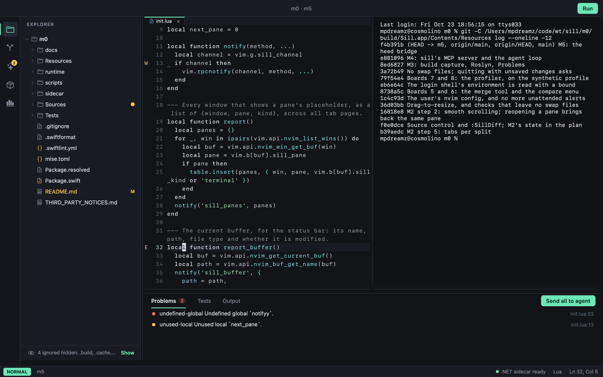
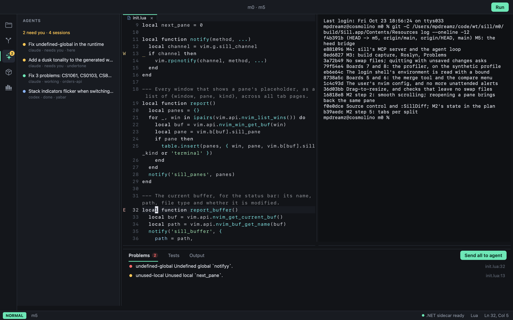
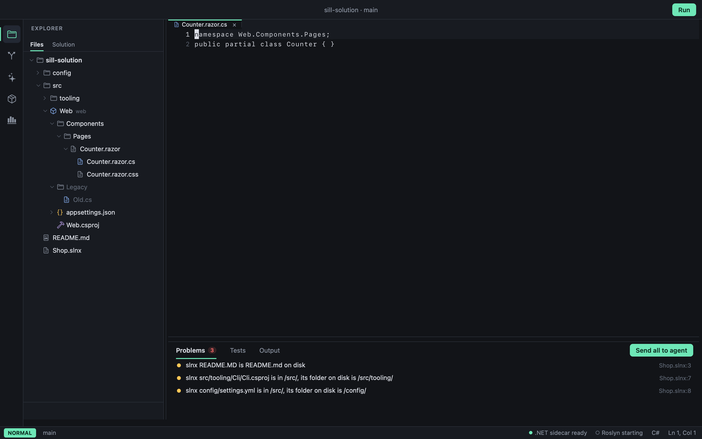
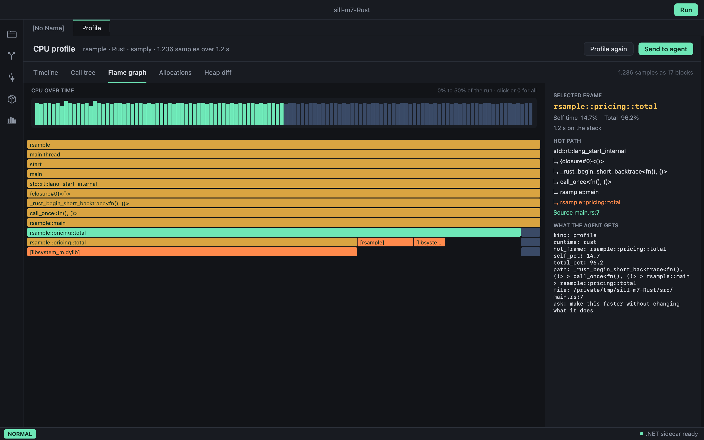
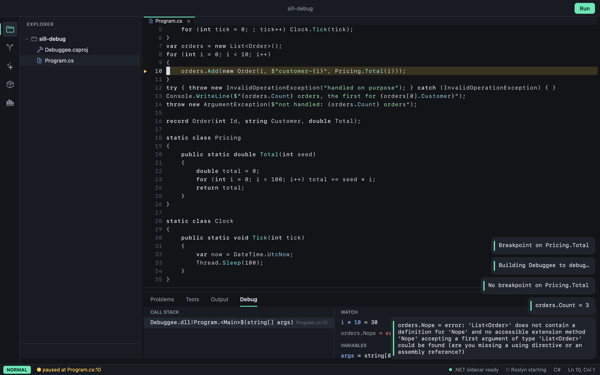

# sill

A native macOS code editor where nvim owns buffers, modes and keymaps and the app owns pixels, windows
and integrations: a Metal-rendered grid, Ghostty terminals as ordinary splits, a profiler, packages,
diff and three-way merge, and a bridge that hands build errors and profiles to a coding agent.

[docs/plan.md](docs/plan.md) is the plan; [docs/designs/](docs/designs/) holds the nine boards. Days 1 to 4 of the
plan's first week are done: sill embeds nvim as a multigrid UI drawn by an instanced Metal grid, and a terminal pane
is a placeholder nvim window with a Ghostty surface drawn over it.

## Building

Tools come from mise (`mise.toml`): Zig for GhosttyKit, SwiftFormat and SwiftLint. Xcode with the Metal toolchain
and nvim 0.12 or later are needed too; `mise run doctor` checks.

```sh
mise run ghostty   # build Vendor/GhosttyKit.xcframework once (without it, panes show a stand-in)
mise run dev       # build and open build/Sill.app
mise run test      # the Swift Testing suite; the nvim tests start a real `nvim --embed`
mise run lint
```






`SILL_SHOWCASE=<file.png>` renders a picture like that one (the window at 1440x900, off screen: a file beside a terminal pane running
`git log`; `SILL_SHOWCASE_FILE` picks the file; `SILL_SHOWCASE_SCENE=profile` shows the profiler instead, `agents` the Agents sidebar over heed's sessions). `SILL_CHECK=project SILL_CWD=<a .NET repo>` measures a real project (load, Roslyn, build) and fails if the UI ever waits over 100 ms. `SILL_CHECK=1 build/Sill.app/Contents/MacOS/Sill` plays the first week in the real app, with key events sent through
the window, and exits non-zero on the first failing step; it also measures idle frames and key-to-screen latency.
`SILL_CHECK_SHOT=<file.png>` saves the window with a pane open. `mise run bench` measures the Metal grid at 4K on a
release build. `SILL_FONTS=<dir>` uses the fonts in a directory without installing them (JetBrains Mono, say).

## Terminal panes

`:SillTerminal` opens one (to the right; `:belowright SillTerminal` and other modifiers place it as they place
`:new`). The pane is an nvim window like any other: `<C-w>hjkl` moves across it, `:resize` and `<C-w>=` size it,
`:only` and `:q` close it. The sidebar and the bottom panel are panes too (`:SillChrome` opens them, as the app does). As with nvim's own `:terminal`, `i` hands the keyboard to the terminal and `<C-\><C-n>`
hands it back; a click on the pane or on the editor does the same.

## As git's merge and diff tool

```sh
git config merge.tool sill
git config mergetool.sill.cmd '"/Applications/Sill.app/Contents/MacOS/Sill" merge "$LOCAL" "$BASE" "$REMOTE" "$MERGED"'
git config mergetool.sill.trustExitCode true
git config diff.tool sill
git config difftool.sill.cmd '"/Applications/Sill.app/Contents/MacOS/Sill" diff "$LOCAL" "$REMOTE"'
```

In a merge, `]x` and `[x` walk the conflicts and `\o`, `\t` and `\b` take ours, theirs or both (`<localleader>`);
`:w` saves the result and `:qa` ends the merge. sill tells git how it went: it exits nonzero when the saved result
still has conflicts in it, or when you give up with `:cq`, and git then keeps the file unmerged. `git difftool
--trust-exit-code` reads `:cq` the same way.

## Files and the solution

The explorer shows the folders on disk, informed by the project files: a project's folder says what kind of project it
is, files nest as Visual Studio nests them (`Counter.razor.cs` under `Counter.razor`), and files a project removes are
dimmed. In a folder with a .slnx it opens on the solution's tree (`s`, or Files | Solution, switches) and says where the
.slnx differs from the folders on disk; `:SillSlnx sync` shows the .slnx rewritten so its folders follow the disk, and
`:SillSlnx apply` writes it.




## C# and Razor

In a .NET folder sill downloads Roslyn's language server (nuget.org's `roslyn-language-server`, into
`~/Library/Caches/sill/roslyn`), and nvim's own LSP client uses it for .cs, .razor and .cshtml files: Razor runs inside
it. Markup gets Razor's answers (components, directives); plain HTML, CSS and JavaScript in it get none yet.

## Profiling

`:SillProfile` builds the program of the project you are in and runs it under the profiler: .NET with EventPipe, a
Cargo package with samply, a Swift package with xctrace (Instruments' Time Profiler). Stop (`x`) shows the CPU
profile: the flame graph and the hot spots with where they are written. For .NET (which needs the sidecar, on your
dotnet 10) Take snapshot (`s`) records the heap while it runs; a second one is compared with the first, object by object,
as a treemap of what grew, and the profile has allocations and collections too. Send to agent gives the hot frame or
the growth to an agent. Above the flame graph, CPU over time: drag across it to see a stretch of the run alone,
click (or 0) for all of it. Selecting a type in the heap diff shows who keeps its objects alive, the path from a GC
root, and the agent is told it too.



## Debugging

F9 puts a breakpoint on the line; F5 builds the project's .NET program and runs it under the debugger (Passenger's
adapter, on your dotnet); when it stops, the line is marked and the panel's Debug tab shows the call stack and the
variables. F10 steps over, F11 in, Shift-F11 out, F5 continues, Shift-F5 stops (`:SillDebug`, `:SillBreakpoint`).


A breakpoint can have a condition (`:SillBreakpoint if i == 3`, or Shift-F9 asks), a hit count (`hits >=5`) or be a
logpoint that writes and goes on (`log order {i}`); `:SillBreakpoint fn Pricing.Total` stops in a method. Paused,
point at a name to see its value, `:SillEval` evaluates the expression under the cursor or the selection, and
`:SillWatch` keeps one in the Debug tab, evaluated at every pause. Exceptions your code does not handle stop the
program and show in the Debug tab (`:SillDebug exceptions all|unhandled|none`). `:SillDebug attach` lists the .NET
processes running and debugs one; Shift-F5 then detaches and leaves it running.



## Settings

⌘, opens the settings window. It writes `~/.config/sill/settings.toml`, which you can also edit by hand ("Open
settings.toml" opens it in sill): the window changes one value in place and keeps your comments, and an edit to the
file applies as soon as it is saved, the font included. ⌘+ and ⌘- change the font's size for the session, ⌘0 goes back. The first start writes every setting commented out at its default. A key sill
does not know, or a value it cannot use, is named at the top of the window. Settings cover what only sill has (the
font, the chrome, which nvim config, the agents, dotnet, heed); what nvim has an option for stays in your nvim config.


## Packages

The activity bar's packages (`:SillPackages`) reads the solution's NuGet packages with the SDK (`dotnet list package`):
vulnerable ones first, with the advisory and the version that fixes it (from osv.dev), then deprecated and outdated
ones (their newest versions from nuget.org). Update moves one to its fix or its newest patch in the file that says its
version (Directory.Packages.props or the project); Update security and patches does every one at once; Ask agent hands
it to an agent to update and run the tests. j/k move, 1 to 5 filter, u updates, a asks, r reads again.


## Language servers

Beside Roslyn, sill starts rust-analyzer, sourcekit-lsp, marksman, the HTML, CSS and JSON servers and TypeScript's own
server the first time you open such a file, unless your nvim config already runs one for it. It uses yours when they
are on your PATH; otherwise it downloads them into `~/Library/Caches/sill/servers` (the web servers with your npm).

## Agents

sill runs an MCP server for the agents you use. Any agent can use it with the config sill writes to
`$TMPDIR/sill-mcp-<pid>.json` (it runs `nc -U` on sill's socket). Its tools: `problems`, `build`, `read_file` and
`open_file`. An agent's first build asks you first.

Send all to agent (in the Problems panel, or `:SillAgent send`) gives the problems to an agent with sill's server
configured. With [heed](https://github.com/heed-build/heed) running, the agent starts there, or the session already
working in this folder gets them, and the Agents sidebar lists heed's sessions, those that need you first; Return
opens one in heed, and `<leader>a` (`:SillAgent next`) goes to the next that needs you. Without heed, `claude` (or
`SILL_AGENT`) runs in a terminal pane. `SILL_HEED_AGENT` picks heed's agent (claude by default); `HEED_CONTROL`
points at another heed's control socket.

`SILL_CHECK=m5` checks the bridge against a heed whose claude is a stand-in (see the M5 note in docs/plan.md).

## Layout

| Path | |
|---|---|
| `Sources/SillNvim` | nvim over msgpack-RPC, lifted from Veil |
| `Sources/SillCore` | the screen model built from redraw events, and the session that runs nvim |
| `Sources/SillInput` | AppKit input in nvim's terms: key notation, mouse modifiers, wheel steps |
| `Sources/SillRender` | the Metal grid: glyph atlas, instanced passes, render thread; the flame graph's level of detail, the treemap |
| `Sources/SillTerminal` | the Ghostty surface, from heed |
| `Sources/SillApp` | the AppKit app: the frame, the sidebar (explorer, source control), the panel, tabs per split |
| `runtime/` | sill's nvim runtime (`:SillTerminal`, the placeholder buffers) |
| `Sources/SillSidecar`, `Sources/SillAgent` | the .NET sidecar's client (Roslyn, the profiler); the MCP server and heed's control socket |
| `sidecar/` | the .NET sidecar (`Sill.Sidecar`) and the profiler it runs (`Sill.Profiler`, from Passenger) |

Third-party code and licences: [THIRD_PARTY_NOTICES.md](THIRD_PARTY_NOTICES.md).
