# sill

The editor you leave running in the background to look in on what your coding agents did and are doing.

## Home

Started from the Dock (or at login), sill is Home, for one question: does anything need me, and where? Its headline
answers in a line ("2 to look at · 3 agents working", and the newest walkthrough under it). Under it, every git
checkout in the folders you watch (asked for the first time; any number of them, and a folder that is itself a
checkout asks whether its parent is meant), each worktree included wherever it is, by repository, the one last active
first. Each checkout says the one reason it is worth a look, in its colour: new from an agent (the walkthrough's
title), an agent working (what it was asked, read from Claude Code's own session record), done, or files changed.
What has been quiet for a week folds away (`z` shows it). At the right, the selected checkout before you go in: its
new walkthroughs in their agents' own words, what it holds, and what ↵ does: it opens the checkout on its newest
walkthrough, `o` on the checkout alone, `m` marks its walkthroughs read without opening them, `n` goes to the newest
anywhere. A walkthrough opened in sill is read. The menu bar's eye counts the agents working; its menu lists them and
what is new. A checkout opens in a sill of its own. Home paints from what it saw last at once and reads again in the
background (2.3 s for 94 checkouts), then follows the file system: an agent's turn ending, an edit, a commit, a
walkthrough seen, each re-reads only its checkout. Nothing is written into the repositories it watches, and git's
index is never locked.

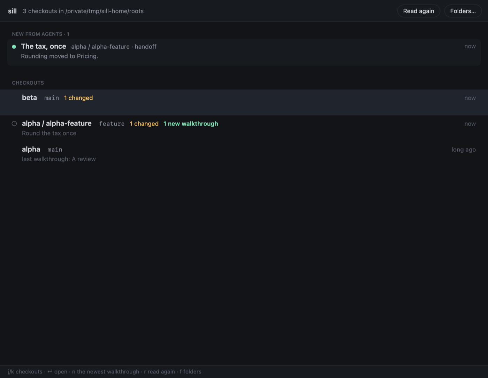

## A checkout: the story first

A checkout opened from Home opens in this sill, a window each (again: its window to the front). It opens on what
happened, not on the code: its new walkthrough from an agent when there is one, else its summary (`:SillSummary`,
`␣iu`, the rail's top icon, `gs`), which answers "what happened here since I looked, and is it any good?". On top a
headline (the new walkthrough's title, else what happened, counted: "2 prompts, 2 commits and 4 files changed since
main") and its verdicts (the agent working or done, walkthroughs not read, commits and lines since the base). Under
it, at the left, the walkthrough to read, in its agent's words, and the session as a line through time: what was
asked, what was committed, when you last looked. At the right, what the agent said to run (`R` runs the first, with
when it last ran) and where it changed, by folder, each file's churn as a bar. `↵` does what the summary is for:
reads the walkthrough not read, else reviews what changed since you looked, else the branch; `v` reviews the branch
against where it left its base, `w` opens the newest walkthrough. The explorer opens on the touched files (Touched |
Files | Solution, `⇥` for the next). The rail has the story on top (summary, walkthroughs, review) and the browsing
under a rule (explorer, changes, agents, map, baskets). Closing a checkout's window, or `:qa` in it, ends that
checkout alone; Home stays.

Since you last looked: leaving sill (another app in front, or the checkout's window closed) notes the worktree as it
is; coming back after five minutes or more makes that the point the summary starts from ("Since you last looked, 2 h
ago: 3 prompts · 1 commit · 7 files changed") and the review has it as a baseline (`V` in the summary). A glance at a
terminal does not move it.

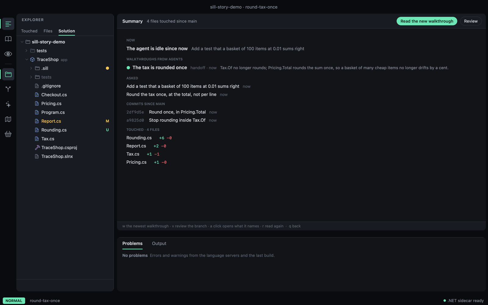

## Run

What a checkout can run, found from its project files (nothing built or asked of a tool): .NET programs (one per
launch profile) and test projects, Swift executables and test targets, Cargo binaries and tests, package.json scripts
(with the package manager its lockfile names), mise tasks and just recipes. The Run pane (the rail's play icon) lists
what the branch touched first, then what was run before, then the rest; a row runs (↵), runs with its command line
changed first (`e`), debugs (`d`, .NET) or profiles (`p`, .NET, Cargo, Swift). ⌘R runs the last again; ⇧⌘R picks
one and asks for its command line, to change before it runs (`:SillRun`). What was run, as it was changed, is kept in
the repository's `.sill/run.json`; it runs in a terminal at the bottom.

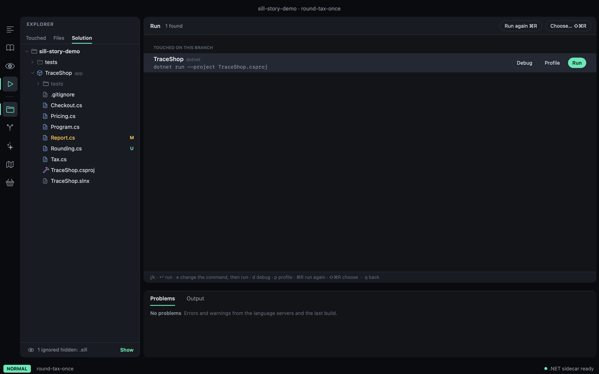

## Handoffs

An agent that finishes a task hands it off: a walkthrough in the repository's `.sill/handoffs/` with what changed
and why, the files to read in order (a sentence each on what to look for) and what to run to see it work (`@run
Name: command`, a cell the notebook runs into a terminal). Home marks it new; the checkout opens on it; the Run pane
and ⇧⌘R offer its runs first. Agents learn it from sill: a session's first prompt is told how (by sill's hooks), the
agents sill starts call its `sill_handoff` tool, and any other agent can write the file itself (`:SillWalk skill`
installs the skill that says how).

## Explorer

A native macOS explorer of a codebase, for steering the coding agents that change it. nvim owns buffers, modes and
keymaps and the app owns pixels, windows and integrations: a Metal-rendered grid, a code map, traces, baskets of
what an investigation found, reviews of what an agent did, and Ghostty terminals as ordinary splits. The tools of an
IDE (build, run, debug, a profiler, packages) are in the Project menu, out of the way until needed.

The activity bar on the left is the front door: Explorer, Changes and Agents switch the sidebar; under a rule, the
code map, the baskets and the review open their panes, and the icon of the one showing is lit. A pane opens in place
of the code, with one header (what it shows, its actions) and its keys along the bottom; `q` puts the code back.

### Keys in sill's own panes

Home, the summary, the review, Run and every other pane sill draws take keys the same way, from one list. A key means
the same thing in every pane where it means anything: `↵` does what the pane is for, `a` hands something to the agent,
`r` reads again, `x` takes away or stops, `m` marks seen, `w` is a walkthrough, `v` a review, `j`/`k` move and `J`/`K`
step through what a row holds (a file's changes, a walkthrough's steps). Each pane's footer shows its keys as keys.

- `g` then a letter goes somewhere, and while it waits a panel lists what can follow: `gh` Home, `gs` the summary,
  `gw` the newest walkthrough, `gv` the review, `gr` Run, `gm` the code map, `gp` the pull request, `gb` the baskets,
  `ge` the explorer, `gc` the changes, `ga` the agents. A sequence sill does not finish goes to nvim (`gt` still
  changes tab).
- `?` lists every key of the pane you are in, `f` puts a label on everything that can be clicked (type it to click).
- Every command has a name (`review.keep`, `go.summary`): `:SillKey review.keep` runs it, and `[keys]` in the settings
  gives it other keys (`review.keep = "Y"`, or a list).

In the review `y` keeps a change, `x` takes it back, `c` comments and `a` sends the comments.

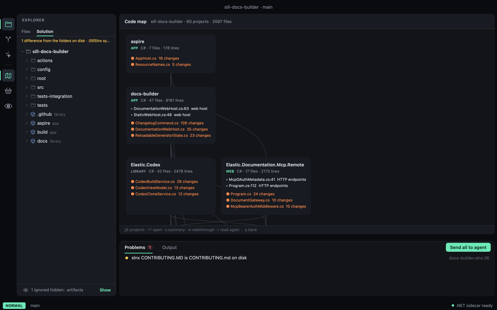

[docs/plan.md](docs/plan.md) is the plan; [docs/designs/](docs/designs/) holds the nine boards. Days 1 to 4 of the
plan's first week are done: sill embeds nvim as a multigrid UI drawn by an instanced Metal grid, and a terminal pane
is a placeholder nvim window with a Ghostty surface drawn over it.

## The shell

`Sill Shell.app`, built beside sill, is nvim alone in a native window: the same Metal grid, the command line,
completion and messages as native views, your own nvim config, and nothing else (no explorer, panel, sidecar or
agents). It has no title bar by default; the window keeps macOS's rounded corners and shadow and moves by its margin
(`title_bar = true` under `[shell]` in the settings brings the buttons back). ⌘+, ⌘- and ⌘0 size the font; ⌘, opens
the settings in it.

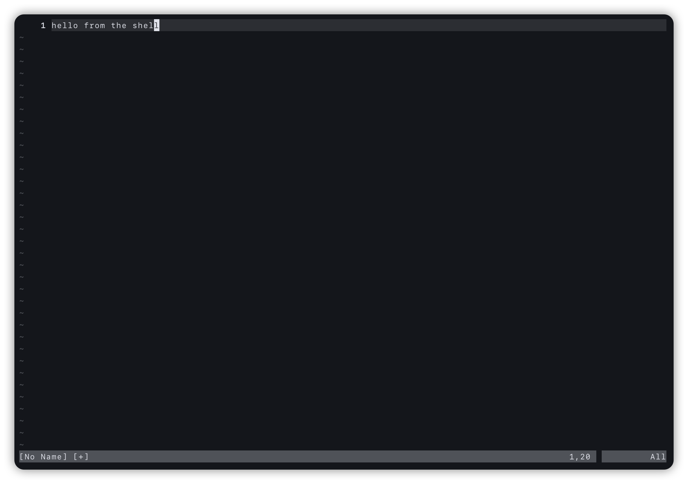

## Building

Tools come from mise (`mise.toml`): Zig for GhosttyKit, SwiftFormat and SwiftLint. Xcode with the Metal toolchain
and nvim 0.12 or later are needed too; `mise run doctor` checks.

```sh
mise run ghostty   # build Vendor/GhosttyKit.xcframework once (without it, panes show a stand-in)
mise run dev       # build and open build/Sill.app
mise run test      # the Swift Testing suite; the nvim tests start a real `nvim --embed`
mise run lint
```

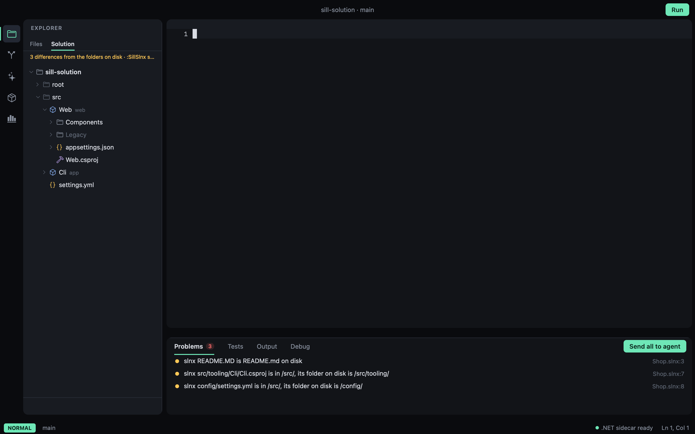


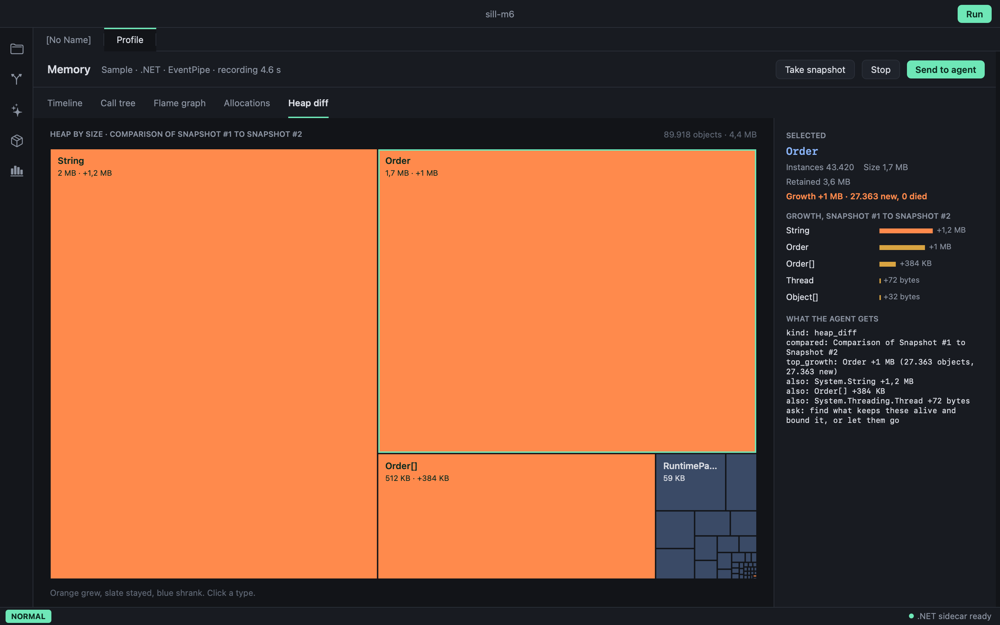

`SILL_SHOWCASE=<file.png>` renders a picture like that one (the window at 1440x900, off screen: a file beside a terminal pane running
`git log`; `SILL_SHOWCASE_FILE` picks the file; `SILL_SHOWCASE_SCENE=profile` shows the profiler instead, `agents` the Agents sidebar over heed's sessions). `SILL_CHECK=project SILL_CWD=<a .NET repo>` measures a real project (load, Roslyn, build) and fails if the UI ever waits over 100 ms. `SILL_CHECK=1 build/Sill.app/Contents/MacOS/Sill` plays the first week in the real app, with key events sent through
the window, and exits non-zero on the first failing step; it also measures idle frames and key-to-screen latency.
`SILL_CHECK_SHOT=<file.png>` saves the window with a pane open. `mise run bench` measures the Metal grid at 4K on a
release build. `SILL_FONTS=<dir>` uses the fonts in a directory without installing them (JetBrains Mono, say).

## Terminal panes

`:SillTerminal` opens one (to the right; `:belowright SillTerminal` and other modifiers place it as they place
`:new`). The pane is an nvim window like any other: `<C-w>hjkl` moves across it, `:resize` and `<C-w>=` size it,
`:only` and `:q` close it. The sidebar and the bottom panel are panes too (`:SillChrome` opens them, as the app does). As with nvim's own `:terminal`, `i` hands the keyboard to the terminal and `<C-\><C-n>`
hands it back; a click on the pane or on the editor does the same.

⌘-click on a file an agent, a compiler or a stack trace names in a pane (`src/Foo.cs:42`, `Foo.swift:42:7`,
`Foo.cs(42,7)`, `Foo.cs#L42`, `in /src/Foo.cs:line 42`, `File "foo.py", line 42`, or just a path) opens it in the
editor at that line. Paths are looked up from where the shell is, then from the project; only files that exist
open. Hyperlinks a program prints (OSC 8) work the same way: one to a file (`file:///abs/src/Foo.cs#L42`) opens in
the editor at that line, whatever its text says; other links open in the browser.

Other apps hand sill a place with a link, `sill://open?path=/abs/src/Foo.cs&line=42&column=7`, or a file (`open -a
Sill Foo.cs`); sill opens it in the editor, starting in the file's repository if it was not running.

## As git's merge and diff tool

```sh
git config merge.tool sill
git config mergetool.sill.cmd '"/Applications/Sill.app/Contents/MacOS/Sill" merge "$LOCAL" "$BASE" "$REMOTE" "$MERGED"'
git config mergetool.sill.trustExitCode true
git config diff.tool sill
git config difftool.sill.cmd '"/Applications/Sill.app/Contents/MacOS/Sill" diff "$LOCAL" "$REMOTE"'
```

In a merge, `]x` and `[x` walk the conflicts and `\o`, `\t` and `\b` take ours, theirs or both (`<localleader>`);
`:w` saves the result and `:qa` ends the merge. sill tells git how it went: it exits nonzero when the saved result
still has conflicts in it, or when you give up with `:cq`, and git then keeps the file unmerged. `git difftool
--trust-exit-code` reads `:cq` the same way.

## Files and the solution

The explorer shows the folders on disk, informed by the project files: a project's folder says what kind of project it
is, files nest as Visual Studio nests them (`Counter.razor.cs` under `Counter.razor`), and files a project removes are
dimmed. In a folder with a .slnx it opens on the solution's tree (`⇥`, or Files | Solution, switches) and says where the
.slnx differs from the folders on disk; `:SillSlnx sync` shows the .slnx rewritten so its folders follow the disk, and
`:SillSlnx apply` writes it.

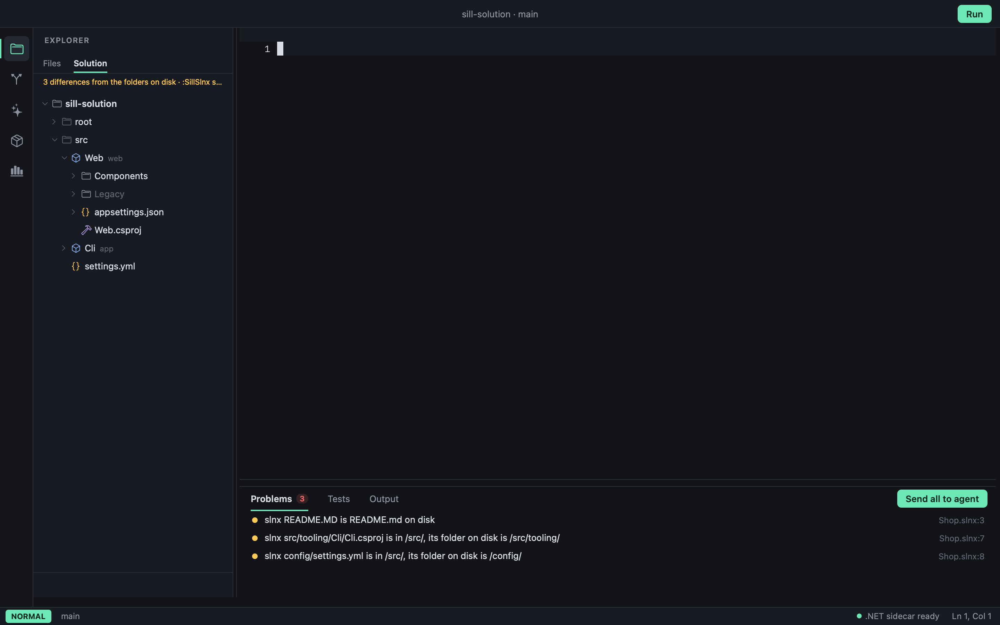


## C# and Razor

In a .NET folder sill downloads Roslyn's language server (nuget.org's `roslyn-language-server`, into
`~/Library/Caches/sill/roslyn`), and nvim's own LSP client uses it for .cs, .razor and .cshtml files: Razor runs inside
it. Markup gets Razor's answers (components, directives) and the HTML server's: hover and completion for HTML, the CSS
in a `<style>` and the JavaScript in a `<script>`, as VS Code's Razor extension has them (the HTML server is the one
sill uses for .html files).

## Profiling

`:SillProfile` builds the program of the project you are in and runs it under the profiler: .NET with EventPipe, a
Cargo package with samply, a Swift package with xctrace (Instruments' Time Profiler). Stop (`x`) shows the CPU
profile: the flame graph and the hot spots with where they are written. For .NET (which needs the sidecar, on your
dotnet 10) Take snapshot (`s`) records the heap while it runs; a second one is compared with the first, object by object,
as a treemap of what grew, and the profile has allocations and collections too. Send to agent gives the hot frame or
the growth to an agent. Above the flame graph, CPU over time: drag across it to see a stretch of the run alone,
click (or 0) for all of it. Selecting a type in the heap diff shows who keeps its objects alive, the path from a GC
root, and the agent is told it too.


## Debugging

F9 puts a breakpoint on the line; F5 builds the project's .NET program and runs it under the debugger (Passenger's
adapter, on your dotnet); when it stops, the line is marked and the panel's Debug tab shows the call stack and the
variables. F10 steps over, F11 in, Shift-F11 out, F5 continues, Shift-F5 stops (`:SillDebug`, `:SillBreakpoint`).

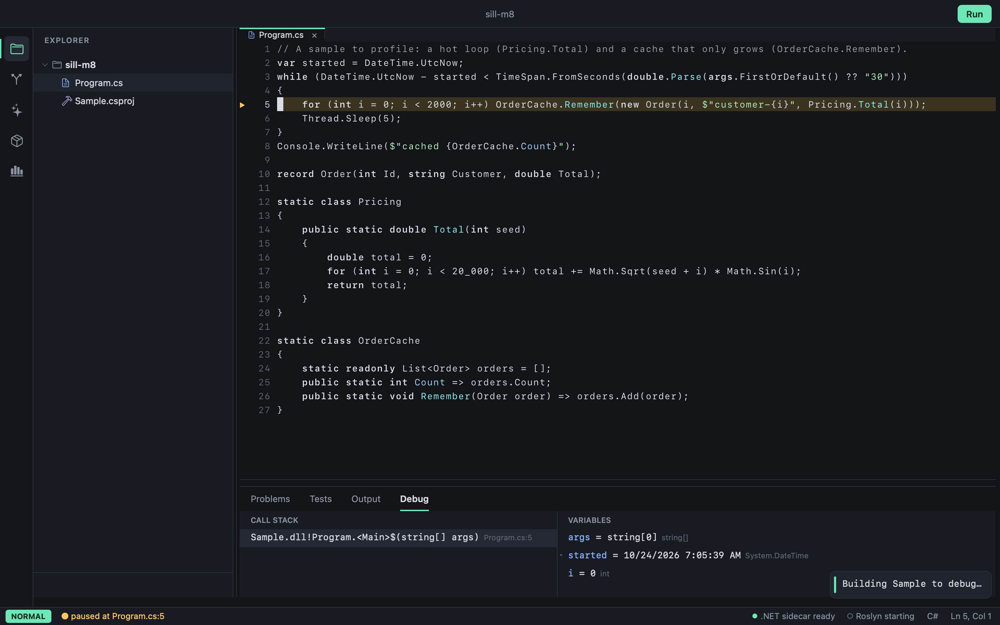

A breakpoint can have a condition (`:SillBreakpoint if i == 3`, or Shift-F9 asks), a hit count (`hits >=5`) or be a
logpoint that writes and goes on (`log order {i}`); `:SillBreakpoint fn Pricing.Total` stops in a method. Paused,
point at a name to see its value, `:SillEval` evaluates the expression under the cursor or the selection, and
`:SillWatch` keeps one in the Debug tab, evaluated at every pause. Exceptions your code does not handle stop the
program and show in the Debug tab (`:SillDebug exceptions all|unhandled|none`). `:SillDebug attach` lists the .NET
processes running and debugs one; Shift-F5 then detaches and leaves it running.


## Islands and zen

The explorer, each editor window and the panel are rounded islands on a darker canvas (`islands` in the settings, on by
default). `:SillZen` (⌃⌘Z, View ▸ Zen) hides the bars, the explorer and the panel and centres the text in a
100-column island; again brings everything back.

## sill's own nvim

By default sill runs its own nvim setup, not yours: nothing to install or configure, and the editor in the same
colours as everything around it (`colors/sill.lua`, from sill's palette: plain text first, structure tinted, comments
faint, problems loud). Code is coloured by tree-sitter: the first time sill runs it builds the parsers for the
languages it knows (C#, Razor, F#, TypeScript, JavaScript, Rust, Swift, Python, Go, Java, Kotlin, Ruby, the web's,
the config files', 25 in all, well under a minute on an M-series Mac) in the background, each grammar at the revision nvim-treesitter pins,
with nvim-treesitter's queries, into `~/Library/Caches/sill/treesitter`; once a week it asks for nvim-treesitter's
newest pins and builds again only what moved. It needs the Command Line Tools' `cc` (`xcode-select --install`);
without them nvim's own syntax files colour the code. The sign column marks what changed since the branch left its
base (committed or not, so an agent's commits stay marked) and tints the line number; `]h` and `[h` go to the next and
previous change. Completion comes from the language server as you type, in sill's own menu; `<leader>ff` (or
`:find`) finds a file fuzzily among the ones git knows, `<leader>/` searches the code, `<leader>e` shows the explorer;
nvim's own LSP keys (`grn`, `gra`, `grr`, `gri`, `K`, `[d`, `]d`) work as they are. Problems are underlined, and the
line under the cursor shows its own. Additions of yours go in `~/.config/sill/init.lua`.

`[nvim] config = "yours"` in the settings runs your own nvim config (`~/.config/nvim`) instead. sill then tells it it
runs inside sill (`vim.g.sill`, for a plugin spec's `cond = not vim.g.sill`) and turns off what it draws itself: a start
screen, noice's command line and messages, a notifier, an explorer taking over a folder.

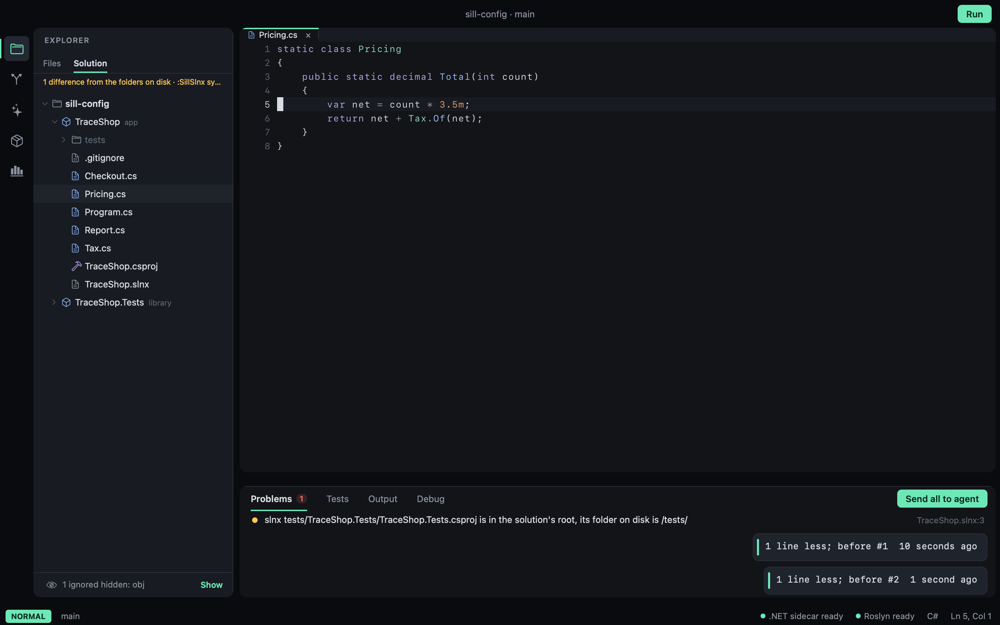

## Settings

⌘, opens the settings window. It writes `~/.config/sill/settings.toml`, which you can also edit by hand ("Open
settings.toml" opens it in sill): the window changes one value in place and keeps your comments, and an edit to the
file applies as soon as it is saved, the font included (terminal panes follow it, a point smaller). ⌘+ and ⌘- change the
font's size for the session, ⌘0 goes back. The first start writes every setting commented out at its default. A key sill
does not know, or a value it cannot use, is named at the top of the window. Settings cover what only sill has (the
font, the chrome, which nvim config, the agents, dotnet, heed); what nvim has an option for stays in your nvim config.

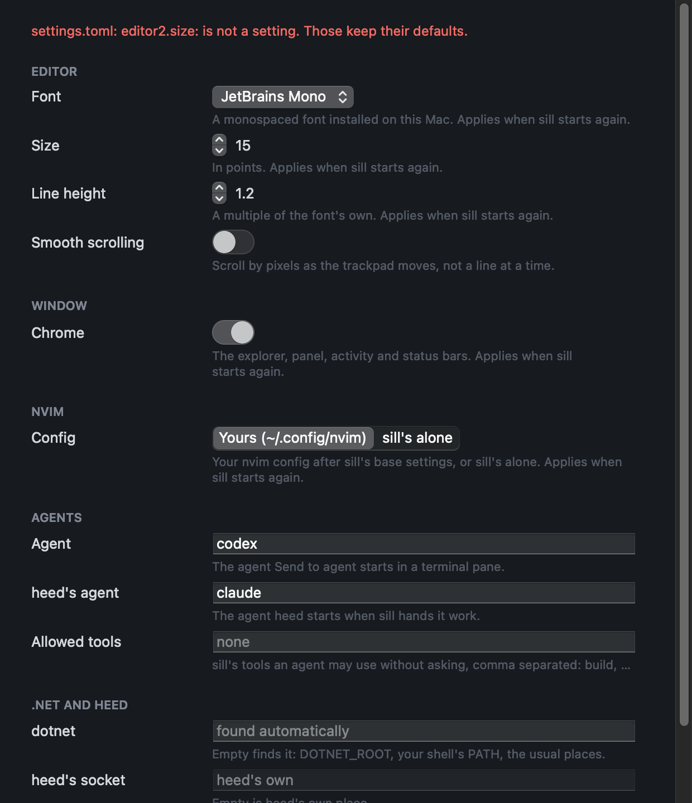

## Packages

Packages (the Project menu, `:SillPackages`) reads the solution's NuGet packages with the SDK (`dotnet list package`):
vulnerable ones first, with the advisory and the version that fixes it (from osv.dev), then deprecated and outdated
ones (their newest versions from nuget.org). Update moves one to its fix or its newest patch in the file that says its
version (Directory.Packages.props or the project); Update security and patches does every one at once; Ask agent hands
it to an agent to update and run the tests. j/k move, 1 to 5 filter, u updates, a asks, r reads again.

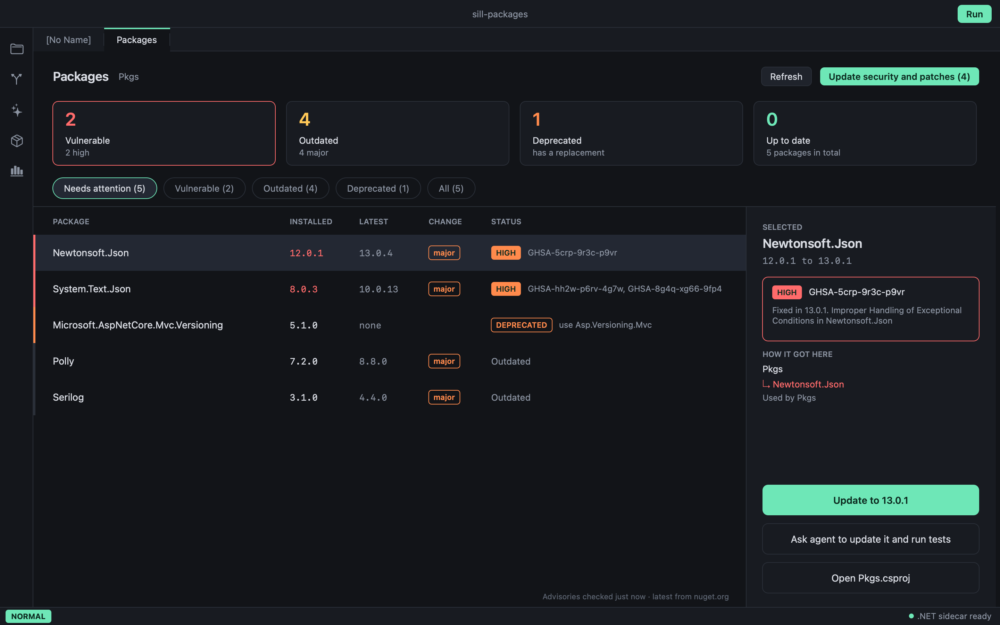

## Logs, traces and metrics

`:SillTelemetry` watches a running .NET program (it picks among those running, or takes a pid) without changing it:
its logs (Microsoft.Extensions.Logging), its traces (every ActivitySource, as a waterfall of each request's spans) and
its metrics (every Meter, the program's own first, each over a sparkline), read through EventPipe by sill's sidecar.
An agent asks the same through `telemetry_watch`, `telemetry_logs`, `telemetry_traces` and `telemetry_metrics`.
`:SillTelemetry stop` ends it; the program goes on.

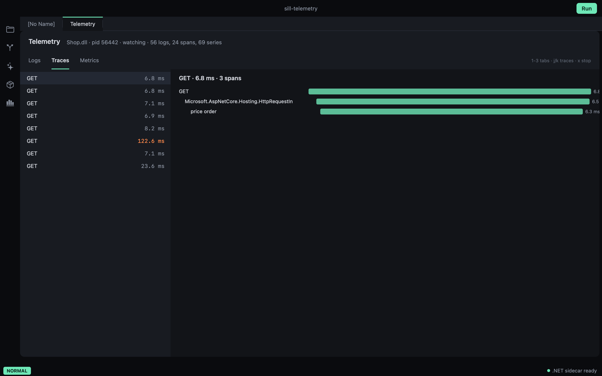

## Asking about code

`:SillAsk` on a selection (or `:20,25SillAsk why is this here?`) sends the lines and your question to the agent
working here; its answer comes back through sill's `annotate` tool and shows under the lines, beside the code it is
about. `:SillAsk clear` removes the answers.

## Agent hooks

With Claude Code's hooks, an agent tells sill what it does instead of sill guessing. The agents sill starts get them
(`--settings`); `:SillHooks install` puts them in the project's `.claude/settings.local.json` for every agent there
(your settings kept beside it as `settings.local.json.before-sill`, neither ever committed; `:SillHooks remove` takes
them out). Each hook sends its event to sill over a socket of this worktree's and does nothing when sill is not
running.

- Every prompt is a review baseline, and so is the end of each turn: a review per prompt.
- Every prompt is told what you are looking at in sill, so "why does this round twice?" means the code in front of
  you: the file and line open, the lines selected (still selected, or the last selection of the past ten minutes) and
  the basket open. Only what changed since the session's last prompt is told again. `editor_context = false` under
  `[agents]` turns it off.
- The files the agent's tools edit are followed as its own.
- Planning is noticed when it starts; the plan opens as a notebook (`.sill/plans/`) with the code it names as cells
  while it is drafted, is marked presented when it is put to you, and an approved plan names the review baseline it
  starts from.
- Each session's events are logged in `.sill/sessions/<session>.jsonl`.
- While an agent's investigation is open, an edit gets a reminder that investigations are read-only (it is not
  refused) and is noted in the basket; a turn that ends without findings marks the basket *stopped*, and `A` in it asks
  for them.

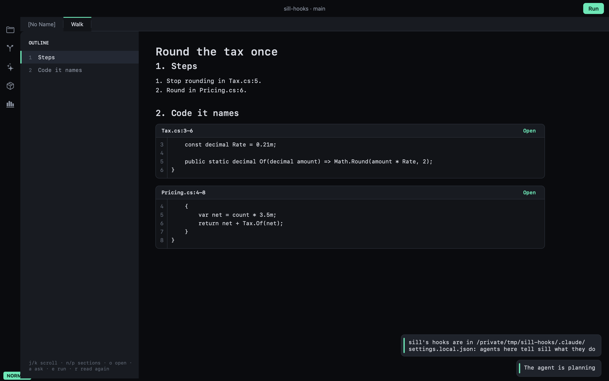

## The branch's pull request

Agents commit and open the pull requests; sill reads them back for whoever looks next. It finds the pull requests of
the worktree's branch with `gh` (read only: sill never writes to GitHub) and says what needs attention: checks
failing, changes requested, a conflict with the base, commits here not pushed, and what is awaited (checks running, a
review, commits behind the base). The status bar names it beside the branch (`#12 · 2 checks failing`); a click, or
`:SillPR` (`␣ip`), opens its pane with the checks, the reviews and comments, and Send to agent. Review (`v`) shows
its changes in the Review pane, against where the branch left its base (a baseline pinned there), with comments for
the agent as any review; Walkthrough (`w`) asks the agent for a review walkthrough of the same changes. The agent reads the
same with sill's `pull_request` tool, and its next prompt is told when something about the pull request changed.
sill reads it when it starts, when its window comes to the front, every two minutes while it is, and after an agent's
turn.

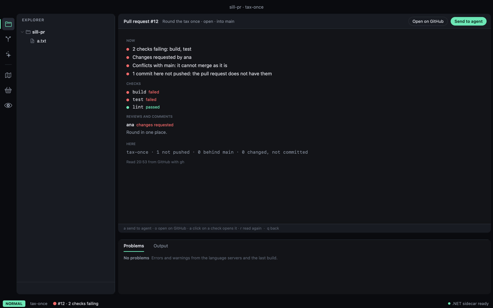

## Replaying a session

`:SillReplay` (`␣ih`, Code ▸ Replay a Session…) picks one of the agent sessions sill's hooks logged and replays it:
its prompts down the left, with what the agent's tools did for the one selected (the files it read and wrote, the
commands it ran, its plan presented and approved), and that turn's changes on the right, file by file. A turn's
changes are between the worktree as it was at its prompt and at its end (git trees, kept by git for two weeks).
`↵` opens a file at its first change, beside the replay.

## Following an agent

sill watches the worktree while an agent works: every file it changes is marked in the explorer for the session, and
`:SillFollow` opens each change in a Follow tab at its first changed line as it lands (your own windows stay as they
are). The status bar names the last change, or the file an agent is reading through sill's MCP server. Your own writes
from sill, build output and what git ignores are not followed.

## The code map

`:SillMap` draws the repository for someone who does not know it: its projects (.NET project files, Swift package
targets, Rust, Node and Python packages) in rows, each above what it references, with what kind each is, how big,
where it starts (`Main`, a web host, HTTP endpoints, `@main`, `fn main`) and the files git history changes most. A
click opens a project, an entry point or a hot file. `a` asks the agent for a summary, which it puts on top with
`code_map_summary` (kept in `.sill`, never committed); `w` asks it for a walkthrough of the codebase. The map is
built from the files git tracks and their last 2,000 commits, so it is there in about a second even for 60 projects;
an agent gets the same through the `code_map` tool.

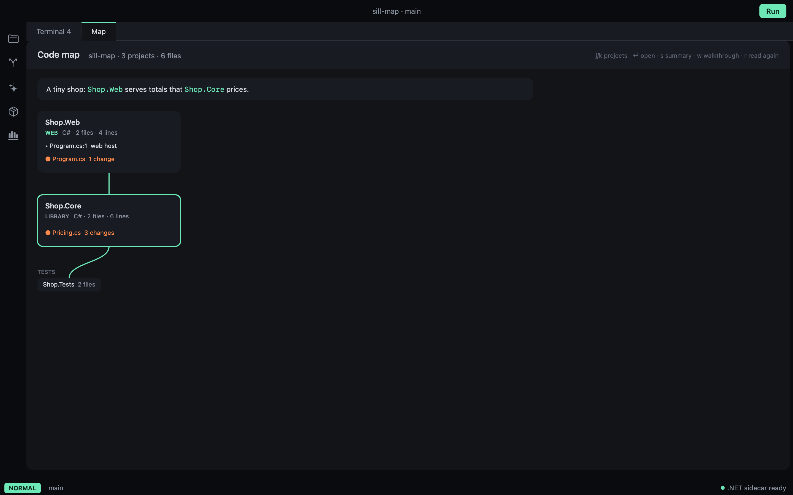

## Tracing a symbol

`:SillTrace` on a symbol shows who calls it as a tree, a level at a time as you open it (`l`/`h`, or a click);
`:SillTrace callees`, or `t` in the pane, shows what it calls instead. A caller opens in the editor where it makes the
call (`↵`, or a double click). `a` sends the path from the symbol to the selected row to the agent to explain, each
step with its code. The tree comes from the language server's call hierarchy (Roslyn for C#), asked without making
nvim wait; an agent gets the same through `trace_symbol` (by `Type.Member`, a few levels deep), and you see it as it
asks.

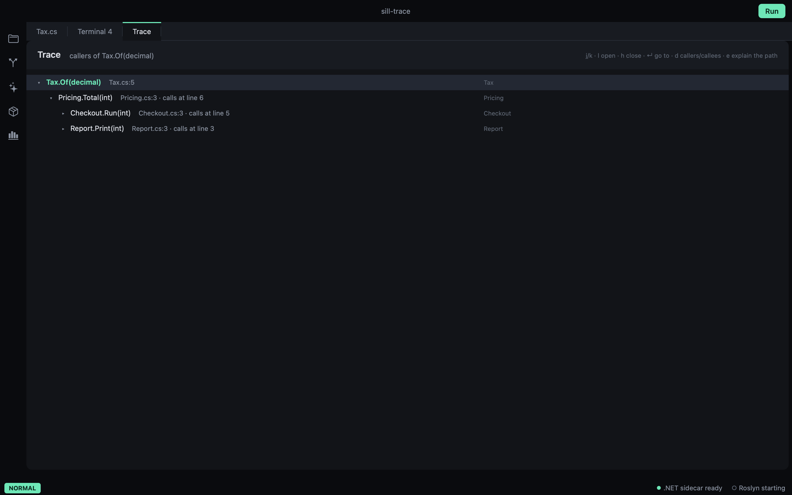

## Keys for understanding code

Everything here is a command; the keys are under `<leader>i`, set only where your config has nothing (which-key shows
them as "sill: understand"). The menu bar's **Code** menu lists them too, with the key and command on hover, and the
right-click menu has the ones that act on the code under it.

| Key | Command | ⌘ |
|---|---|---|
| `<leader>ib` (a selection: its lines) | `:SillBasket add` | ⇧⌘B |
| `<leader>iB` | `:SillBasket` (pick a basket) | |
| `<leader>is` | `:SillBasket send <question>` | |
| `<leader>it` / `<leader>iT` | `:SillTrace` / `:SillTrace callees` | ⇧⌘H |
| `<leader>ia` (a selection) | `:SillAsk` | |
| `<leader>ii` | `:SillInvestigate <question>` | ⇧⌘I |
| `<leader>im` | `:SillMap` | ⇧⌘M |
| `<leader>iw` | `:SillWalk` | |
| `<leader>ir` | `:SillReview` | |
| `<leader>if` | `:SillFollow` | |

## Context baskets

Collect the code you want to ask about while you read, then ask about all of it at once. `:SillBasket add [note]` adds
the selected lines (or the current one; `:%SillBasket add` the whole file) to the current basket, and `b` in the trace
pane adds a caller with how it calls; you stay where you are. Lines that touch or overlap a piece already in the
basket join it. `:SillBasket new <title>` starts a basket, `:SillBasket` picks one, `:SillBasket send <question>` (or
`a` in its pane) gives the agent the question with every piece and note, the code as it is now, and the agent's answer
is written back into the basket as its findings (`basket_conclude`). A sent basket is closed: the next piece starts a
new one.

Baskets are files, `.sill/baskets/*.basket.md` (one `.sill` for the repository, like `.git`: at the main worktree,
whichever worktree you open, its paths read in the worktree you are in), in the walkthrough format (`@code` anchors with a fingerprint of the
code when it was added, notes as prose, `@trace Symbol callers 2` for a call tree), private to the repository. They
show as a notebook: a piece whose code has changed since it was added is marked, and the left menu switches (Tab)
between the outline, the files the basket touches, and its context.

As a piece goes in, sill collects what it can about it, beside the basket (`*.basket.context.json`, so the basket
stays prose): its project, the symbol around it with its signature and the first sentence of its documentation, the
tests that reach it, how often its lines changed and the last commit, and the problems in it. The facts show next to
the piece's heading, `i` opens them, the Context menu sums them up across the basket (projects, tests, who changed
the code last), and agents get them with the code (`basket_read`, and in `basket_add`'s answer).

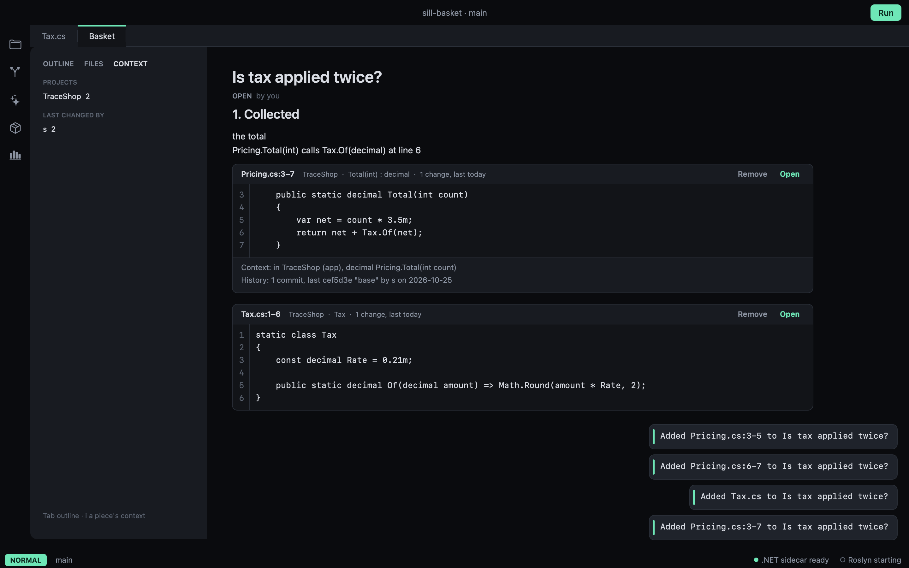

## Investigations

`:SillInvestigate <question>` asks the agent to find something out through sill, read-only, into a basket you watch
fill: it makes one (`basket_create`), orients with `code_map` and `trace_symbol`, adds each place that matters with a
note on why (`basket_add`, grouped in sections), notes call trees and what it ruled out (`basket_note`), uses the
debugger, profiler and telemetry when reading is not enough (they ask you first), and ends with its findings
(`basket_conclude`): the answer, why it is sure, what is open, what to do next. `basket_list` and `basket_read` let it
come back to one. The sill-investigate skill teaches an agent all this, so it can start an investigation on its own;
`:SillInvestigate skill` installs it for Claude Code. You can add your own pieces to its basket and send it back with a
follow-up.

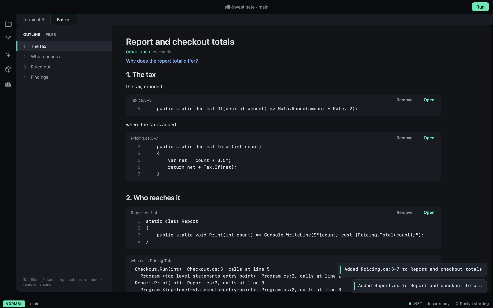

## Walkthroughs

A walkthrough is a Markdown file ending in `.walk.md`, anywhere, that walks someone through code: `## steps` of prose,
`@code` anchors (a symbol such as `Pricing.Total`, found by the language server so it survives edits, or a file and
lines) and `@ask` questions. `:SillWalk` opens one as a notebook: one scrolling document with an outline, the code each anchor points at now
(an anchor that no longer resolves flagged), `@diff` for a change and `@example` for a script that runs in place. Ask the agent about a step and its answer is written into the file under the
question. Agents write them with the sill-walkthrough skill (`:SillWalk skill` installs it in `~/.claude/skills`) and
use `walkthrough_check`, `walkthrough_open` and `walkthrough_answer` through sill's MCP server.

```markdown
---
title: How an order reaches the database
for: Orders.slnx
---
## Pricing
The total of an order: `seed` times each step.
@code Pricing.Total
@ask Why multiply by the seed?
```

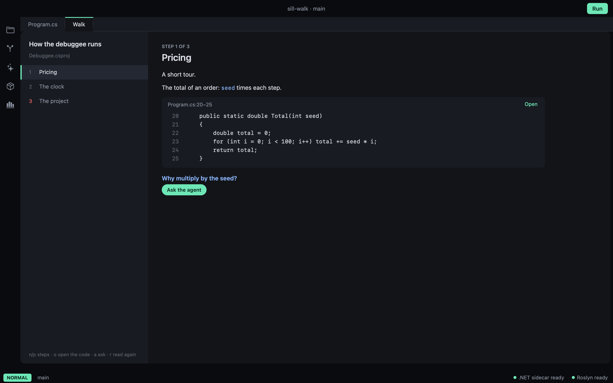

## Reviewing what an agent changed

`:SillReview` shows what changed since a baseline: the files with their counts, and each change to keep, take back
(the file as the baseline had it there) or comment on. Send review hands the comments to the agent working here, each
with its file, line and change. Baselines are taken when sill opens, when work is sent to an agent, when an agent's
turn ends (its heed session stops working) and with `:SillReview mark`; Return opens a file beside its baseline in
nvim's diff. A file moved (and changed a little) is one rename, as GitHub counts it, shown with where it was. A
baseline is a git tree of the worktree written through a temporary index: your index and history are
left alone.

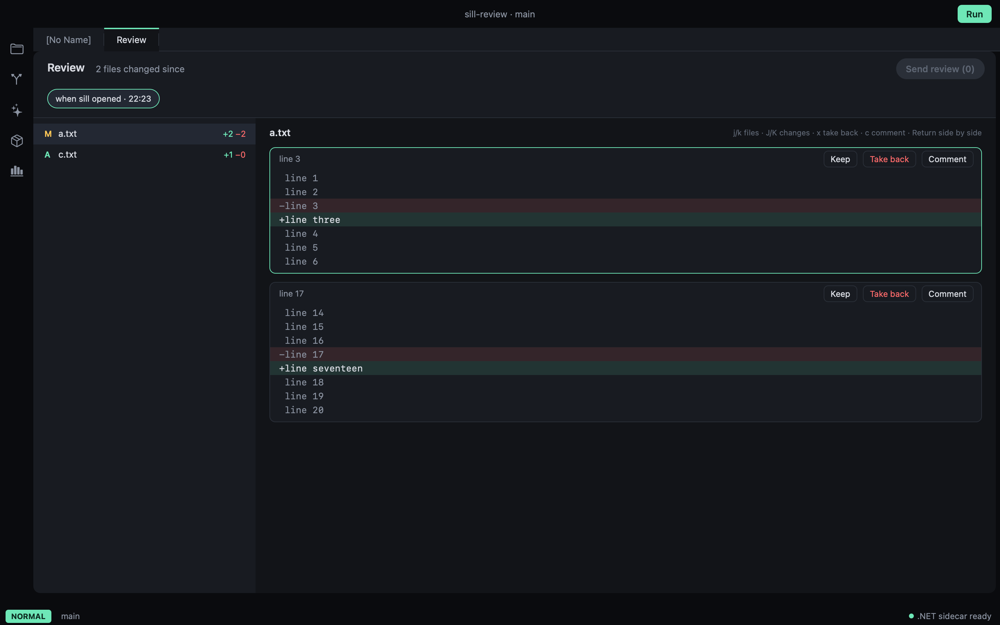

A file is marked seen with `m` (then the next not seen), a whole area with `M`; the marks are kept in `.sill` with the
file's content then, so a file the agent changes again is not seen any more. A change of 20 files or more in more
than one place is read by area (its folder two levels deep, the most changed first), each with how much of it is seen
as a bar; an area all seen folds to its heading. How much is left is at the top right ("10 of 23 seen", and what was
kept or is to be sent), each change is named by the function git finds around it, and its buttons say their keys
(`y` keep, `x` take back, `c` comment); `a` sends the comments, and the button says how many.

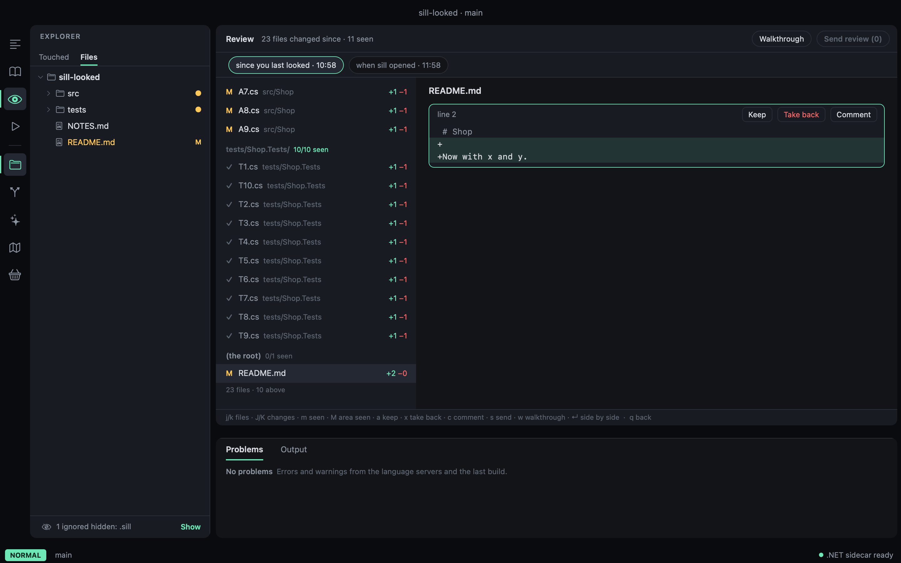

Walkthrough (`w`) asks the agent for a walkthrough of the changes to review: a throwaway notebook inside the
repository's `.sill` folder (private, never committed) that goes through them by idea, with each part's diff and usage examples of what changed as
isolated scripts (a .NET 10 file-based app referencing the changed project, or a TypeScript, Python, Rust or Swift
script). It opens as one scrolling document with an outline; Run runs an example in place, its output under it.

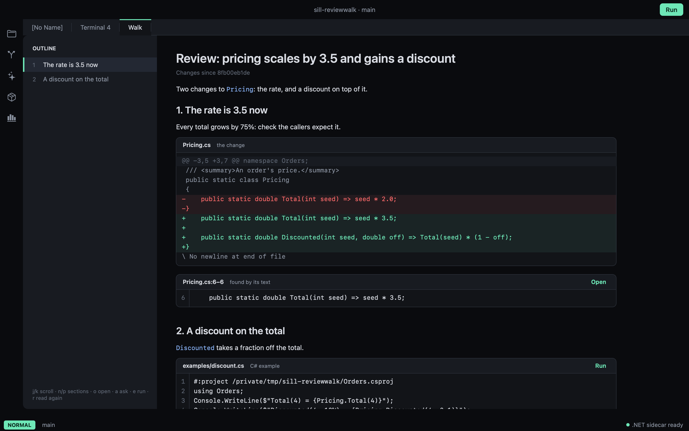

## An agent debugging and profiling, in view

sill's MCP server gives an agent the debugger and the profiler, and sill shows what it does as it does it:
`debug_breakpoint` (a condition, a hit count, a log message) appears as a sign, `debug_start` and `debug_step` run the
program to a pause and answer where it is, with the stack and the locals, `debug_evaluate` lands in the Debug tab, and
`debug_attach` and `debug_stop` complete it. `profile_start`, `profile_snapshot` and `profile_stop` record a run in the
profile tab; profile before a change and after it and `profile_compare` (and the Compare tab) show each function's
time in both, with its share of each run. Starting a program asks you first, unless `allow` in the settings names
`debug` or `profile`. Your own keys work all along: F5 takes it back.

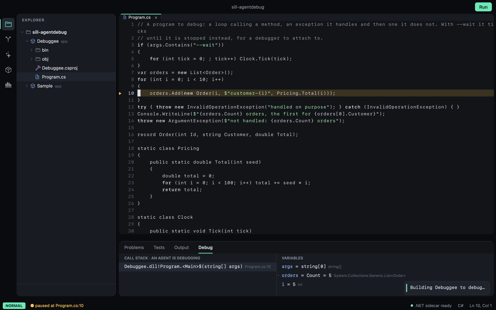

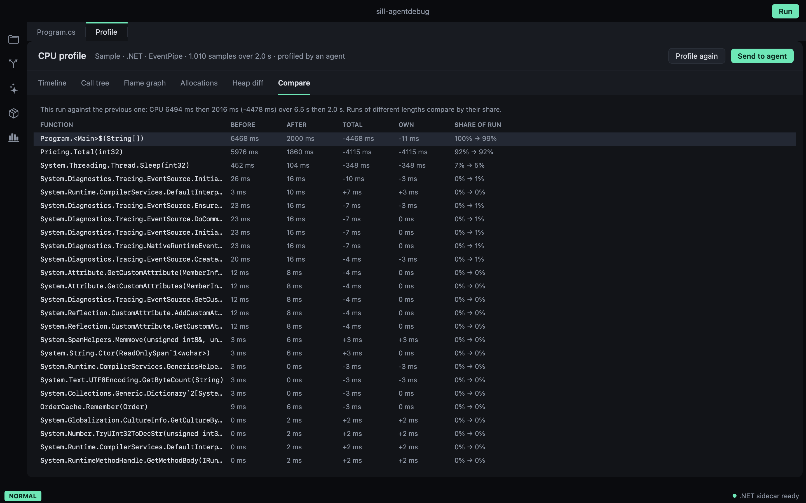

## Language servers

Beside Roslyn, sill starts rust-analyzer, sourcekit-lsp, marksman, the HTML, CSS and JSON servers, TypeScript's own
server and fsautocomplete for F# the first time you open such a file, unless your nvim config already runs one for it.
It uses yours when they are on your PATH; otherwise it downloads them into `~/Library/Caches/sill/servers` (the web
servers with your npm, fsautocomplete as a .NET tool).

## Agents

sill runs an MCP server for the agents you use. Any agent can use it with the config sill writes to
`$TMPDIR/sill-mcp-<pid>.json` (it runs `nc -U` on sill's socket). Its tools: `problems`, `build`, `read_file` and
`open_file`. An agent's first build asks you first.

Send all to agent (in the Problems panel, or `:SillAgent send`) gives the problems to an agent with sill's server
configured. With [heed](https://github.com/heed-build/heed) running, the agent starts there, or the session already
working in this folder gets them, and the Agents sidebar lists heed's sessions, those that need you first; Return
opens one in heed, and `<leader>a` (`:SillAgent next`) goes to the next that needs you. Without heed, `claude` (or
`SILL_AGENT`) runs in a terminal pane. `SILL_HEED_AGENT` picks heed's agent (claude by default); `HEED_CONTROL`
points at another heed's control socket.

`SILL_CHECK=m5` checks the bridge against a heed whose claude is a stand-in (see the M5 note in docs/plan.md).

## Layout

| Path | |
|---|---|
| `Sources/SillNvim` | nvim over msgpack-RPC, lifted from Veil |
| `Sources/SillCore` | the screen model built from redraw events, and the session that runs nvim |
| `Sources/SillInput` | AppKit input in nvim's terms: key notation, mouse modifiers, wheel steps |
| `Sources/SillRender` | the Metal grid: glyph atlas, instanced passes, render thread; the flame graph's level of detail, the treemap |
| `Sources/SillTerminal` | the Ghostty surface, from heed |
| `Sources/SillApp` | the AppKit app: the frame, the sidebar (explorer, source control), the panel, tabs per split |
| `runtime/` | sill's nvim runtime (`:SillTerminal`, the placeholder buffers) |
| `Sources/SillSidecar`, `Sources/SillAgent` | the .NET sidecar's client (Roslyn, the profiler); the MCP server and heed's control socket |
| `sidecar/` | the .NET sidecar (`Sill.Sidecar`) and the profiler it runs (`Sill.Profiler`, from Passenger) |

Third-party code and licences: [THIRD_PARTY_NOTICES.md](THIRD_PARTY_NOTICES.md).
