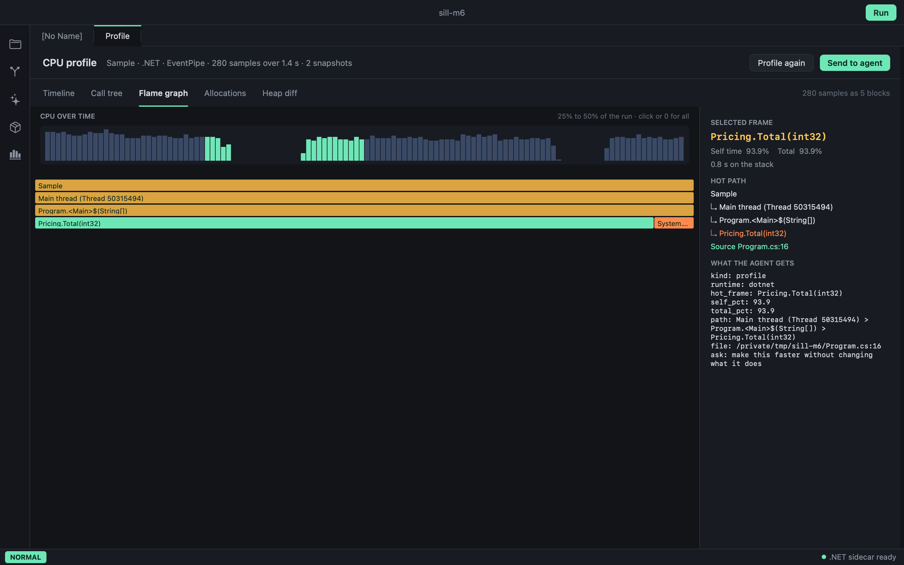

# sill

A native macOS code editor where nvim owns buffers, modes and keymaps and the app owns pixels, windows
and integrations: a Metal-rendered grid, Ghostty terminals as ordinary splits, a profiler, packages,
diff and three-way merge, and a bridge that hands build errors and profiles to a coding agent.

[docs/plan.md](docs/plan.md) is the plan; [docs/designs/](docs/designs/) holds the nine boards. Days 1 to 4 of the
plan's first week are done: sill embeds nvim as a multigrid UI drawn by an instanced Metal grid, and a terminal pane
is a placeholder nvim window with a Ghostty surface drawn over it.

## Building

Tools come from mise (`mise.toml`): Zig for GhosttyKit, SwiftFormat and SwiftLint. Xcode with the Metal toolchain
and nvim 0.12 or later are needed too; `mise run doctor` checks.

```sh
mise run ghostty   # build Vendor/GhosttyKit.xcframework once (without it, panes show a stand-in)
mise run dev       # build and open build/Sill.app
mise run test      # the Swift Testing suite; the nvim tests start a real `nvim --embed`
mise run lint
```




`SILL_SHOWCASE=<file.png>` renders a picture like that one (the window at 1440x900, off screen: a file beside a terminal pane running
`git log`; `SILL_SHOWCASE_FILE` picks the file; `SILL_SHOWCASE_SCENE=profile` shows the profiler instead). `SILL_CHECK=1 build/Sill.app/Contents/MacOS/Sill` plays the first week in the real app, with key events sent through
the window, and exits non-zero on the first failing step; it also measures idle frames and key-to-screen latency.
`SILL_CHECK_SHOT=<file.png>` saves the window with a pane open. `mise run bench` measures the Metal grid at 4K on a
release build. `SILL_FONTS=<dir>` uses the fonts in a directory without installing them (JetBrains Mono, say).

## Terminal panes

`:SillTerminal` opens one (to the right; `:belowright SillTerminal` and other modifiers place it as they place
`:new`). The pane is an nvim window like any other: `<C-w>hjkl` moves across it, `:resize` and `<C-w>=` size it,
`:only` and `:q` close it. The sidebar and the bottom panel are panes too (`:SillChrome` opens them, as the app does). As with nvim's own `:terminal`, `i` hands the keyboard to the terminal and `<C-\><C-n>`
hands it back; a click on the pane or on the editor does the same.

## As git's merge and diff tool

```sh
git config merge.tool sill
git config mergetool.sill.cmd '"/Applications/Sill.app/Contents/MacOS/Sill" merge "$LOCAL" "$BASE" "$REMOTE" "$MERGED"'
git config diff.tool sill
git config difftool.sill.cmd '"/Applications/Sill.app/Contents/MacOS/Sill" diff "$LOCAL" "$REMOTE"'
```

In a merge, `]x` and `[x` walk the conflicts and `\o`, `\t` and `\b` take ours, theirs or both (`<localleader>`);
`:w` saves the result and `:qa` ends the merge.

## Agents

sill runs an MCP server for the agents you use. Any agent can use it with the config sill writes to
`$TMPDIR/sill-mcp-<pid>.json` (it runs `nc -U` on sill's socket). Its tools: `problems`, `build`, `read_file` and
`open_file`. An agent's first build asks you first.

Send all to agent (in the Problems panel, or `:SillAgent send`) gives the problems to an agent with sill's server
configured. With [heed](https://github.com/heed-build/heed) running, the agent starts there, or the session already
working in this folder gets them, and the Agents sidebar lists heed's sessions, those that need you first; Return
opens one in heed, and `<leader>a` (`:SillAgent next`) goes to the next that needs you. Without heed, `claude` (or
`SILL_AGENT`) runs in a terminal pane. `SILL_HEED_AGENT` picks heed's agent (claude by default); `HEED_CONTROL`
points at another heed's control socket.

`SILL_CHECK=m5` checks the bridge against a heed whose claude is a stand-in (see the M5 note in docs/plan.md).

## Layout

| Path | |
|---|---|
| `Sources/SillNvim` | nvim over msgpack-RPC, lifted from Veil |
| `Sources/SillCore` | the screen model built from redraw events, and the session that runs nvim |
| `Sources/SillInput` | AppKit input in nvim's terms: key notation, mouse modifiers, wheel steps |
| `Sources/SillRender` | the Metal grid: glyph atlas, instanced passes, render thread; the flame graph's level of detail |
| `Sources/SillTerminal` | the Ghostty surface, from heed |
| `Sources/SillApp` | the AppKit app: the frame, the sidebar (explorer, source control), the panel, tabs per split |
| `runtime/` | sill's nvim runtime (`:SillTerminal`, the placeholder buffers) |

Third-party code and licences: [THIRD_PARTY_NOTICES.md](THIRD_PARTY_NOTICES.md).
