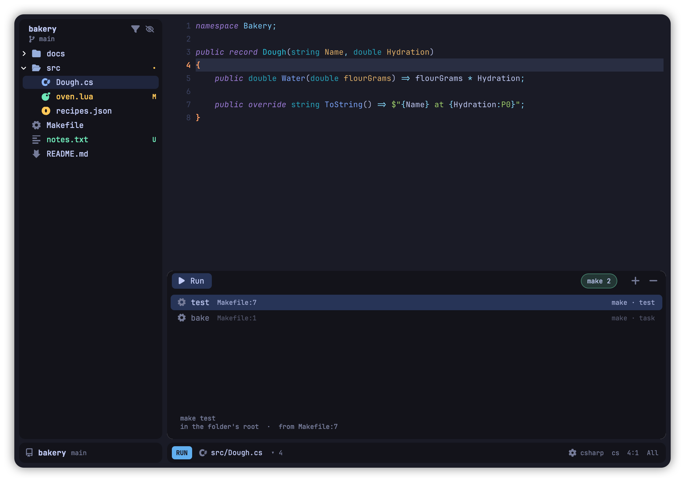
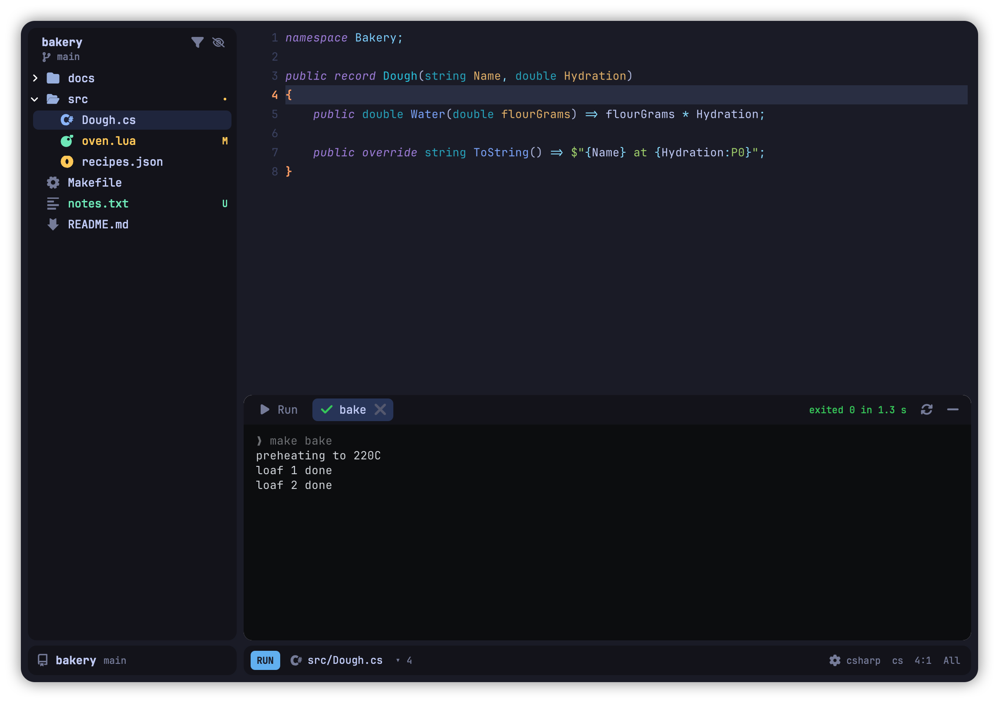

# Run and build

F5 runs, ⇧⌘B builds and ⇧⌘R chooses what to run from everything the folder offers. The output is a real terminal
(Ghostty's) to the right of the code when the window is at least 1300 points wide, under it when it is not. The
keyboard stays in the code. ⌘J goes into the pane and back, ⇧⌘J closes it.

## What can run

It is read from the folder, never built to find out:

- `.sln`, `.slnx`, `.csproj`, `Package.swift` and `Cargo.toml` (build, run, test)
- `Makefile` targets, mise tasks, `justfile` recipes and `package.json` scripts
- VS Code's `.vscode/tasks.json` (the task in the default build group is what ⇧⌘B builds) and
  `.vscode/launch.json` (node, python, .NET and native programs)

F5 runs what was run last in the folder, else the first program.

## The Run pane

The **Run** tab lists everything, each row saying what kind it is and the file it comes from. A pill for each origin
(make, npm, dotnet, VS Code, yours) in the header filters the list, and the details of the highlighted row
(command, folder, environment) are under it.

Return runs one. From then on only its output shows, in a tab of its own.

- The tab says how the run is going (a loader, then ✓ or ✗) and the header how it ended (`exited 0 in 1.3 s`, or the
  code it failed with). The button beside it runs it again in the same tab.
- Several things can run at once, a tab each, up to eight. The cross on a tab ends its run.
- ⇧⌘R from an output goes back to the list, and `o` in the list to the output of the last run.
- Drag the strip between the pane and the code to size it (double-click sizes it back).

## Your own configurations

`c` copies an entry into a configuration of your own to change its arguments, folder and environment variables in a
form. `e` changes one, `d` deletes it, `n` makes a new one. They are kept in Trim's own folder
(`~/Library/Application Support/trim/run`), per project and never in your repository.

## Build

A build runs unseen: the status bar shows a loader, and the pane comes up on its Problems tab only when the build has
errors or warnings, or on its Output tab when it failed with nothing to list. A clean build is a line in the status
bar that goes after a few seconds.
