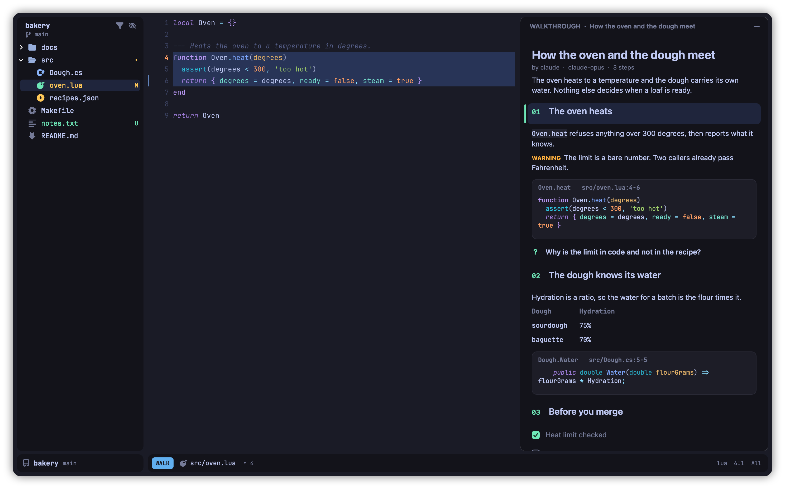

# Walkthroughs

A walkthrough is a guided reading of your code, written by an agent (or by you) and shown in Trim beside the editor.
Each step has its prose, the code it points at as that code is *now*, diagrams, questions and checklists. Where you read
is a real nvim cursor: the editor beside it follows the step you are on.



## Open one

`<leader>W`, View ▸ Walkthroughs… (⌃⌘W) or `:TrimWalk` lists the repository's walkthroughs: the ones agents write into
`.trim/walkthroughs/` (private to this machine, never committed) and any `*.walk.md` in the repository. `:TrimWalk
path/to/x.walk.md` opens one directly, and an agent's `trim walk open` opens it in the window that is on its repository.

## Read it like nvim

The pane is backed by a real nvim buffer (its own, headless), so what you know works: `j` `k`, `/` search, counts, marks,
`:` commands, visual mode, registers. The status bar says WALK, and the mode nvim is in (WALK INSERT...).

| Key | What it does |
|---|---|
| `]]`, `[[` | Next and previous step. The editor beside shows the step's code. |
| `<CR>` | Show this block's code and go to it in the editor. |
| `x` | Tick or untick a checklist item (written to the file). |
| `gr` | Run a `@run` block in the Run pane. Nothing runs by itself. |
| `gs` | Edit the source in the editor. |
| `q`, Escape (in normal mode) | Back to the code. |

Clicking a block moves the cursor there. A step that is written into the file while it is open appears at once.

## What a walkthrough contains

A walkthrough is Markdown. Steps are `##` headings; around them:

- **Prose** with `**bold**`, `*italic*`, `` `code` ``, lists, tables and callouts (`> [!warning] ...`).
- **`@code Pricing.Total`** shows that symbol's lines as they are now, highlighted in your colour scheme.
  `@code src/Pricing.cs:12-30` anchors a file range.
- **`@diff path`** shows a file's change against the walkthrough's `base` (or `HEAD`).
- **`@ask Why is the total not cached?`** marks a question worth asking.
- **`- [ ] Reviewed`** checklists you tick in the pane; the file keeps the state.
- **`@run Tests: dotnet test`** offers a command to run.
- Fenced blocks, shown as highlighted code (Mermaid diagrams are drawn as diagrams in a later release).

Anchors survive edits because a symbol is found by its declaration, not a line number. When the walkthrough is *stamped*, each
anchor records a fingerprint of its code and the commit; a step whose code changed since is marked **changed since written**
and counted in the header, and one that can no longer be found is marked **not found**.

## For agents: the `trim` tool

Trim ships a command line tool for agents to write walkthroughs and check their own work.

```sh
trim walk new "How an order reaches the database"   # a skeleton in .trim/walkthroughs, prints its path
trim walk check .trim/walkthroughs/how-an-order.walk.md   # anchors found? diagrams valid? exit 1 on errors
trim walk stamp .trim/walkthroughs/how-an-order.walk.md   # record each anchor's fingerprint and the commit
trim walk open .trim/walkthroughs/how-an-order.walk.md    # show it in Trim
trim walk list --json
trim walk format            # the skill: the format and the style guide, as agents should follow it
trim skill install          # put the skill in ~/.claude/skills
```

`trim walk check` prints `file:line: error: message` and exits 1 when the walkthrough has errors, or `--json` for a program.
It names anchors that are not found, diagrams of no known kind, a `@link` to a node that is not in the diagram, and steps that
show no code, so an agent can fix its own file before you open it.
