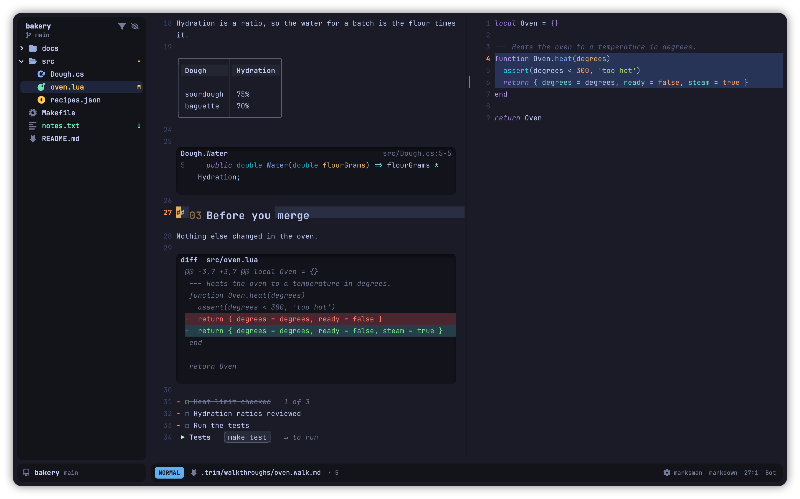

# Walkthroughs

A walkthrough is a guided reading of your code, written by an agent (or by you) and opened in Trim like any file: a tab in
the editor, in the editor's font and your colour scheme. Each step has its prose, the code it points at as that code is
*now*, questions and checklists. It is an ordinary nvim buffer, so every motion, search and command you know works in it,
and the code of the step you are on opens beside it.


The last step of a review: a change as a card, a checklist with its count, and a command to run.



## Open one

`<leader>W`, View ▸ Walkthroughs… (⌃⌘W) or `:TrimWalk` lists the repository's walkthroughs: the ones agents write into
`.trim/walkthroughs/` (private to this machine, never committed) and any `*.walk.md` in the repository. `:TrimWalk
path/to/x.walk.md`, the file tree or `:edit` open one directly, and an agent's `trim walk open` opens it in the window
that is on its repository.

## How it looks while you edit

It is source, styled: the title (`# Heading`) is drawn at twice the size, bold and underlined; step headings (`##`) at one and
a half times; the `#` marks are hidden until the cursor is on the line. `` `Inline code` `` sits in a rounded box (the
backticks are its padding), a border rather than a tint so it never looks like a selection. The front matter is one quiet
line above the title; move the cursor into it and all of it opens. A walkthrough opens with the cursor on the title, past
the front matter. The same styling applies to any markdown file you edit in Trim.

## Tables, callouts, checklists

Away from the cursor, a Markdown table is drawn as an aligned grid (columns aligned as the separator row says, cells wrapped
when the table is wider than the window, `**bold**`, `*italic*`, `` `code` `` and links applied) and a callout
(`> [!warning] text`; also note, tip, important, caution, danger, risk, question, verified, asserted) as a tinted block with an
accent bar in its colour and its kind named; a plain `>` quote has a quiet bar. Move the cursor onto one and it is source
again, so editing is never in the way. Checklist items are boxes (☐ ☑), done items struck through, with a count (`2 of 4`)
on the first item. Fenced blocks sit on a tint with their language named. In a walkthrough the steps are numbered (`01  The oven heats`), and an
`@ask` with the `>` answer after it is a question block (the answer in it, the source again under the cursor). This applies to every markdown file you edit.

## Cards

Under each `@code` (and `@diff`) is a card: a sunken, rounded block set into the page, with a header row (the symbol, the
file and lines, and a chip that says whether the code is still as written), the code highlighted in your scheme with its own
line numbers and wrapped to the window at word boundaries, and for a diff the added and removed lines coloured. A line along the
card's bottom edge is in the colour of whether the code is as written (green, amber, red). The `@code` line itself is hidden
behind its card and shows, to edit, when the cursor is on it. A card longer than 14 rows opens as a peek (its first four rows and
how many more); `za` opens or closes the card the cursor is at, `zR` and `zM` open and close all of them. Cards are as wide as the window and
are drawn again when it is resized.

## Read it like nvim

| Key | What it does |
|---|---|
| `]]`, `[[` | Next and previous step. The code of the step opens beside the walkthrough, its lines marked. |
| `<CR>` on `@code` or a step | Go to that code, in the window beside. |
| `<CR>` on `@run` | Run the command in the Run pane. Nothing runs by itself. |
| `x` on a checklist item | Tick or untick it (it is text in the buffer; save to keep it). |

Move the cursor into another step and the code beside it follows. A step an agent writes into the file while it is open
appears, and typing in the buffer redraws it.

## What a walkthrough contains

A walkthrough is Markdown. After a few lines of front matter (`by`, `for`, `model`; Trim shows them as one quiet line), the first line is the title as `# Heading`, drawn at double height. Steps are `##` headings; around them:

- **Prose** with `**bold**`, `*italic*`, `` `code` ``, lists, tables and callouts (`> [!warning] ...`).
- **`@code Pricing.Total`** shows that symbol's lines as they are now, highlighted in your colour scheme.
  `@code src/Pricing.cs:12-30` anchors a file range.
- **`@diff path`** shows a file's change against the walkthrough's `base` (or `HEAD`).
- **`@ask Why is the total not cached?`** marks a question worth asking.
- **`- [ ] Reviewed`** checklists you tick with `x`; the file keeps the state.
- **`@run Tests: dotnet test`** offers a command to run.
- Fenced blocks, shown as highlighted code (Mermaid diagrams are drawn as diagrams in a later release).

Anchors survive edits because a symbol is found by its declaration, not a line number. When the walkthrough is *stamped*, each
anchor records a fingerprint of its code and the commit; a step whose code changed since is marked **changed since written**
and counted in the header, and one that can no longer be found is marked **not found**.

## For agents: the `trim` tool

Trim ships a command line tool for agents to write walkthroughs and check their own work.

```sh
trim walk new "How an order reaches the database"   # a skeleton in .trim/walkthroughs, prints its path
trim walk check .trim/walkthroughs/how-an-order.walk.md   # anchors found? diagrams valid? exit 1 on errors
trim walk resolve .trim/walkthroughs/how-an-order.walk.md  # where does each anchor land? file:lines and the first line
trim walk stamp .trim/walkthroughs/how-an-order.walk.md   # record each anchor's fingerprint and the commit
trim walk open .trim/walkthroughs/how-an-order.walk.md    # show it in Trim
trim walk list --json
trim walk format            # the skill: the format and the style guide, as agents should follow it
trim skill install          # put the skill in ~/.claude/skills
```

`trim walk check` prints `file:line: error: message` and exits 1 when the walkthrough has errors, or `--json` for a program.
It names anchors that are not found, diagrams of no known kind, a `@link` to a node that is not in the diagram, and steps that
show no code, so an agent can fix its own file before you open it.
