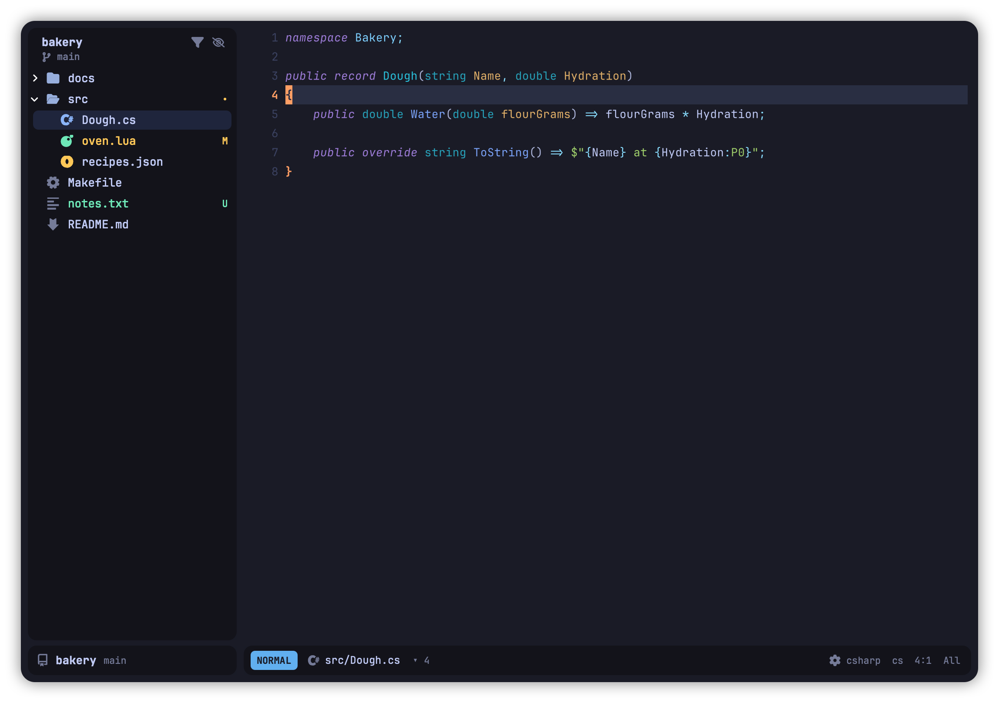

# First steps

## Open a folder

Start Trim from Finder or with a folder:

```sh
open -n -a Trim --args ~/Projects/bakery
```

The file tree is on the left, the editor on the right. The tree shows the folder's files with git's marks
(**M** changed, **U** new) and the branch.



## The keys that matter

The leader key is `\`. These are the first things to learn; everything else you can find through
[which-key](../configuration/plugins.md), which lists the keys after the leader.

| Key | What it does |
|---|---|
| ⌘P | Find a file in the workspace. |
| ⇧⌘F | Find a line of text in the workspace. |
| ⌘⇧O | Switch workspace: another repository or worktree. |
| ⌘B | Hide or show the file tree. ⇧⌘E goes into it. |
| F5, ⇧⌘B | Run, and build. The output comes up beside or under the code. |
| ⌥⌘T | Choose a [colour scheme](../look/themes.md); each is tried as you move. |

## Moving between the tree and the editor

Clicking a file opens it and hands the keyboard to the editor at once. From the editor, `<C-w>h` (or ⇧⌘E) goes
into the tree, and Escape comes back. Inside the tree `j`, `k`, `h`, `l` and Return move and open.

## Your first run

Press ⇧⌘R. Trim lists everything the folder can run: `make` targets, `npm` scripts, .NET projects, VS Code tasks
and more. Return runs one, and its output opens in a tab. See [Run and build](../code/run-and-build.md).
