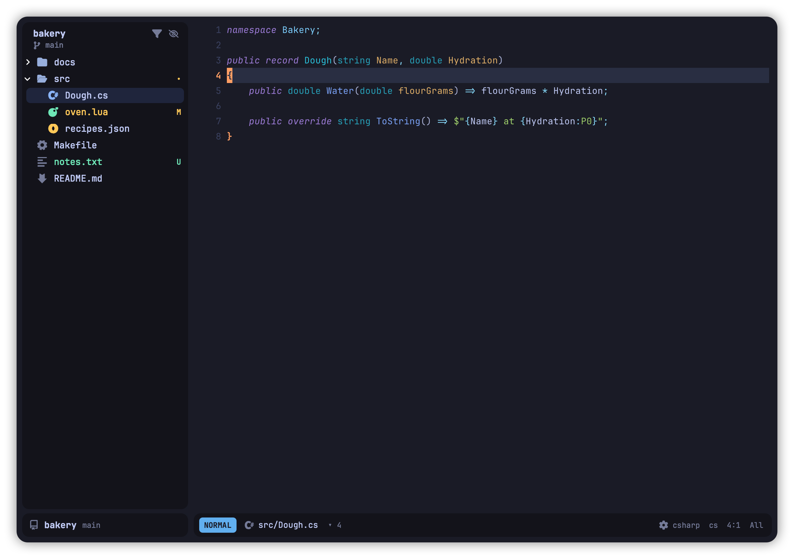

# Trim

A trimmed IDE around Neovim, for the Mac.

Trim puts nvim in a native window and adds only what an editor is missing when you work on a project: a file tree
that knows git, tabs, completion and hover drawn by the window itself, a run and build pane, and a switcher for
the repositories and worktrees you move between. Editing stays what it is, nvim, in its own isolated config, so
nothing in `~/.config/nvim` can break it. It is meant to feel instant: opening a file never waits for a plugin.

Trim comes with **Shim**, a lightweight native nvim for the single file you want to edit quickly, with your own
config. Both install together.

## Where to go next

| | |
|---|---|
| [Getting started](getting-started/index.md) | Install it, open a folder, learn the five keys that matter. |
| [The window](window/index.md) | The file tree, workspaces, tabs and the status bar. |
| [Working with code](code/index.md) | Language servers, completion, run and build, problems, finding. |
| [Look](look/index.md) | Colour schemes and fonts, tried live. |
| [Configuration](configuration/index.md) | `settings.toml`, your own `init.lua`, and plugins. |
| [Shim](shim.md) | nvim alone in a native window, with your own config. |
| [Reference](reference/index.md) | Every key, command and file. |
