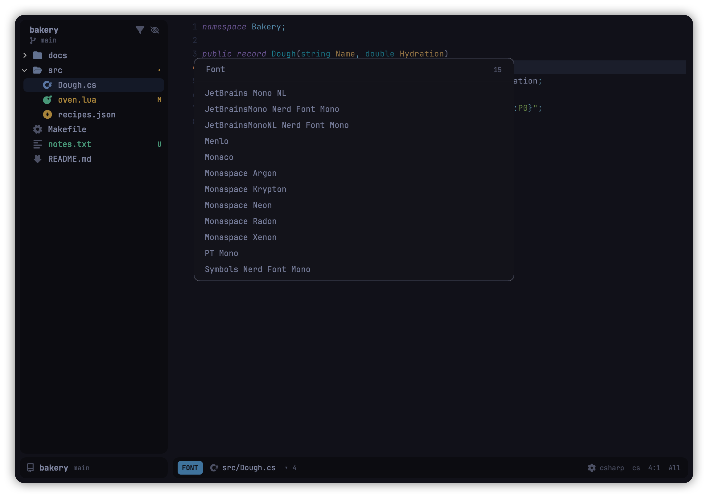

# Fonts

`<leader>F`, View ▸ Font… or `:TrimFont` opens a list of the installed monospaced families.



Each is tried in the editor, the tree and the panes as the keyboard moves. Return keeps one and saves it, Escape puts
the old one back.

```toml
[editor]
font = "JetBrains Mono"
font_size = 13
line_height = 1.2
```

⌘+, ⌘- and ⌘0 change the size for the session without touching the file.

Trim draws its icons with a Nerd Fonts symbols font it carries, so the tree and the status bar never show boxes
whichever font you pick.
