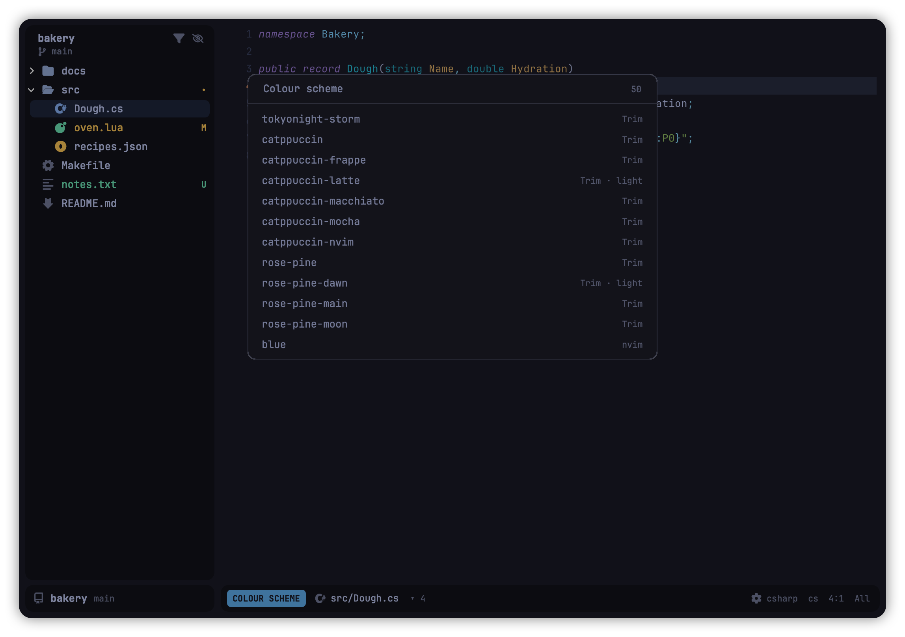

# Colour schemes

`<leader>c`, ⌥⌘T, View ▸ Colour Scheme… or `:TrimTheme` opens the list.



As the keyboard moves through the list each scheme is tried: the editor, the tree, the tabs and the bar follow.

| Key | What it does |
|---|---|
| ↑ ↓ (or `j` `k`) | Move, trying each scheme. |
| `/` | Filter by typing. |
| Return | Keep one and save it in `settings.toml`. |
| Escape | Put the scheme there was back exactly. |

`:TrimTheme name` sets and saves one by name.

Trim carries **tokyonight** (the default, "night"), **catppuccin** and **rose-pine** as pinned plugins, and lists
nvim's own schemes beside them.

```toml
[theme]
colorscheme = "tokyonight-night"
```
