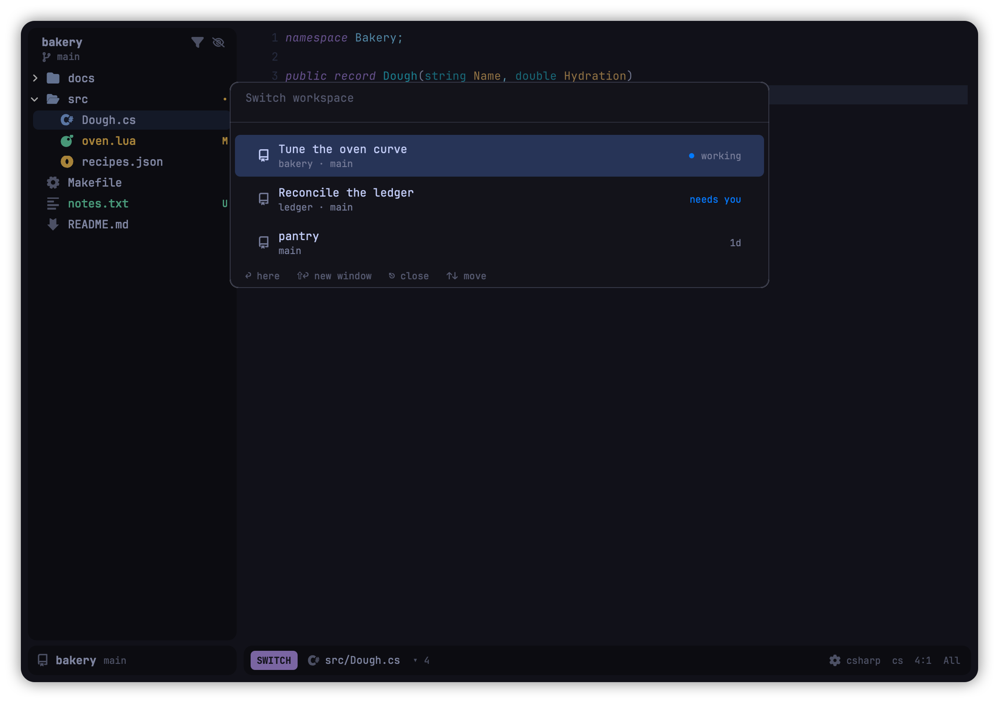

# Workspaces

A workspace is a repository or a worktree. ⌘⇧O (or the button at the foot of the tree, `:TrimWorkspace`,
`<leader>w`) opens the switcher: a search line over the repositories and worktrees under your roots, and the ones
that already have a window.



## The list

Rows are named by what the work is about, not by a folder name nobody remembers. If you use
[heed](https://heed.build/) the row shows the title of its session and whether it needs you; without it the row
shows the branch of a worktree or the name of a repository. The repository and branch stand under it.

The order is the one Trim knows by itself, so the list is there the moment it opens and never shuffles: the
workspaces you opened most recently first. Names and marks fill in as they are found, without moving a row.

## Opening one

| Key | What it does |
|---|---|
| Return | Open it in this window: nvim starts again in its folder and the tree is rooted there. Unsaved changes are asked about first. |
| ⇧Return | Open it in a new window. |
| Return with nothing typed | Go back to the workspace before this one. |
| Escape | Close the switcher. |

A workspace that already has a window is brought forward, never opened twice.

## Where it looks

Under `[home] roots` in [settings.toml](../configuration/settings.md), `~/Projects` by default:

```toml
[home]
roots = ["~/Projects", "~/code/wt"]
```
